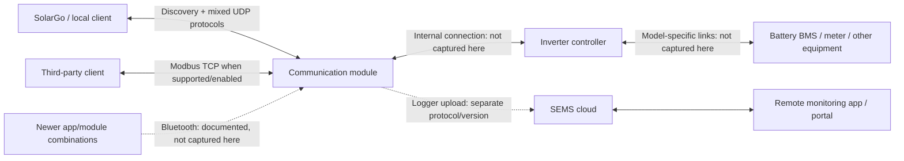

# GoodWe communication ecosystem

The consolidated target reference, identified-operation directories and
register-map selection guide are in [GOODWE_REFERENCE.md](GOODWE_REFERENCE.md).

Evidence reviewed 2026-10-29, Australia/Brisbane. This is an ecosystem map and
coverage contract, not a claim that every GoodWe protocol is understood.
The packet-level investigation remains in [GOODWE_PROTOCOL.md](GOODWE_PROTOCOL.md).
Installed-app warning and parser paths are recorded in
[GOODWE_SOLARGO_722_STATIC.md](GOODWE_SOLARGO_722_STATIC.md).
Reproducible references are catalogued in
[GOODWE_ECOSYSTEM_SOURCES.json](GOODWE_ECOSYSTEM_SOURCES.json).
The latest target-specific reads, configuration limits and EMS investigation are
in [GOODWE_OPERATIONAL_DISCOVERY.md](GOODWE_OPERATIONAL_DISCOVERY.md).

## The system we need to represent

An inverter's network endpoint can expose operations belonging to the inverter,
its communication module and its attached equipment. A working telemetry read
does not demonstrate that module configuration or native-app commissioning works.

The diagram separates logical responsibilities; it does not assert a particular
CPU arrangement or internal serial wiring. In our experiment OpenWatt impersonates
the network-facing module and inverter identity together. The real internal
module-to-inverter link is not being intercepted.

The September 2026 official WiFi/LAN Kit manual documents Bluetooth commissioning,
LAN/WiFi connectivity, third-party Modbus TCP monitoring, and both local and remote
functions in SEMS+. Thus "SolarGo is local, SEMS is cloud" is an incomplete model
for newer products. See the [official module manual, sections 3, 7 and 8](https://en.goodwe.com/Api/downloadFile?id=1982&mid=60&type=2).

## Carriers and wire formats

All three binary families below were interleaved in the same SolarGo UDP/8899
session. A port number does not identify the payload format.

| Plane | Carrier / framing | What is established | Coverage |
| --- | --- | --- | --- |
| Module discovery | UDP 48899, ASCII `WIFIKIT-214028-READ` | Reply supplies IP and module MAC/name-like identity | Wire verified here; implemented |
| Legacy vendor operations | UDP 8899, `AA55 SRC DST CONTROL FN LEN DATA SUM16_BE` | Identity, bulk runtime/settings, registration and execute commands | Reads verified here; control semantics incomplete |
| Registers inside vendor framing | UDP 8899, AA55 `01/1A` with payload `03 OFFSET_BE COUNT` | Register access can coexist with bulk AA55 reads | Reads verified here; individual registers only partly mapped |
| Modbus RTU framing over UDP | UDP 8899, `UNIT FN ... CRC16_LE` request | App uses units F7 and FA; reads are function 03 | Wire verified here; no serial bus is implied by the UDP framing |
| GoodWe-prefixed Modbus response | `AA55 UNIT FN BYTE_COUNT DATA CRC16_LE` | CRC covers the Modbus body after `AA55` | Wire verified here; this is not an AA55 vendor response |
| Module commands | UDP 8899, `5A5A 01 FN LEN16_BE DATA CRC16_LE` | CRC covers the whole preceding frame; 02/03 respond as 82/83 | Two response layouts verified; wider command set unknown |
| Module web management | HTTP over TCP 80 on this module | Unauthenticated `GET /` returns HTTP 401; authenticated status page reports V1.1.3.14 | Read-only GETs verified; no management forms submitted |
| Modbus TCP | TCP 502, MBAP header and Modbus PDU | Separate transport requiring compatible hardware/firmware/configuration | Documented externally; not tested on this module |
| Bluetooth | Model/module-specific BLE or Bluetooth connection | Newer modules support local app configuration | Documented; UUIDs, framing and authentication not captured here |
| Module-to-cloud upload | Separate logger connection | HK1000 research documents an encrypted TCP/20001 uploader | External first-hand evidence, not validated for our ES module |

The reference implementation explicitly distinguishes AA55, AA55-wrapped register
commands, RTU-over-UDP and TCP commands. Its register wrapper and transport classes
are useful implementation evidence, not a universal vendor specification.
[Pinned protocol source](https://github.com/marcelblijleven/goodwe/blob/66dfcdd9cd947bfd799f2bddb40b4e05ba9db6f6/goodwe/protocol.py),
[pinned Modbus source](https://github.com/marcelblijleven/goodwe/blob/66dfcdd9cd947bfd799f2bddb40b4e05ba9db6f6/goodwe/modbus.py).

The HK1000 uploader and ZZ/5A5A observations come from
[the researcher's own teardown](https://smlx.dev/posts/goodwe-sems-protocol-teardown/).
They must not be generalized to all SEMS loggers or interpreted as the SolarGo
local-control transport. A cloud account API is another boundary again.

## Simultaneous use and overlap

SolarGo can discover a module, read inverter identity/runtime/settings with AA55,
read additional registers with Modbus, and query module network settings with
5A5A. These are complementary operations. We have not established why the app
chooses one register-access carrier over another in every case.

The register address space and the wire operation are distinct concepts. Two
commands can expose related data without their complete register maps, units,
permissions or write behaviour being interchangeable. In particular, success
reading one register over TCP would not prove that an AA55 execute operation can
be replaced by a TCP register write.

For the observed ES target:

| Purpose | Example request | Evidence boundary |
| --- | --- | --- |
| Identity | AA55 `01/02` | Real payload verified; proxy overrides inverter serial |
| Runtime | AA55 `01/06` | 140-byte real response; selected fields UI verified |
| Settings | AA55 `01/09` | 86-byte response; some UI scales/dependencies unresolved |
| Capability | AA55 `01/1D` | Real 16-byte payload; field meanings not established |
| Register read | AA55 `01/1A`, start 059C, count 2 | Returned zero words; semantics not established |
| BMS candidate | Modbus F7, register 7506, count 1 | Real/proxy raw 0001 agrees; UI display rules incomplete |
| Alarm history | Modbus F7, register D6D8, count 67 | Several record fields matched to screenshots |
| Network description | 5A5A `03` | Verified ASCII DHCP/IP/mask/gateway/DNS response |
| Credential-shaped description | 5A5A `02` | Three byte-length-prefixed fields; synthetic trial did not visibly populate the app |

At 00:00:33 AEST on Oct 29, SolarGo sent module 02 twice and 03 once. The proxy
logged the trial 02 reply and network 03 reply within a millisecond of the
respective requests. The user reported no visible change. Sent replies establish
server behaviour, not application acceptance. Preserve this negative result.

## Product and version matrix

The compatibility key is a tuple: inverter model/platform, DSP/ARM firmware,
module model/hardware/firmware, app version, connection mode and role. Marketing
family names alone are insufficient.

| Reference grouping | Distinction | Current evidence |
| --- | --- | --- |
| Legacy ES / EM / BP, platform 105 | AA55 bulk operations and register wrappers | Our ESU target belongs here; other hardware not tested |
| ET-style implementation grouping | Includes several newer hybrid platforms, not just products named ET | Separate register codec and model tags in reference source |
| DT / MS / D-NS / XS-style grouping | Separate grid-tied implementation | Different telemetry/register interpretation; not tested here |
| Older Solar-WiFi module | Discovery plus legacy UDP services observed | Web status reports V1.1.3.14; physical module model still unidentified |
| WiFi/LAN Kit-20 generation | WiFi/LAN and Bluetooth configuration | Officially documented; not equivalent to our unidentified module |
| Security/firmware variants | Services, roles and access paths may differ | Must be identified explicitly; no blanket compatibility claim |

These software groupings are taken from the
[pinned model/platform classifier](https://github.com/marcelblijleven/goodwe/blob/66dfcdd9cd947bfd799f2bddb40b4e05ba9db6f6/goodwe/model.py)
and [discovery implementation](https://github.com/marcelblijleven/goodwe/blob/66dfcdd9cd947bfd799f2bddb40b4e05ba9db6f6/goodwe/__init__.py).
They are not a complete GoodWe product taxonomy.

GoodWe's [2023 Modbus TCP configuration document](https://community.goodwe.com/static/images/2023-05-06322243.pdf)
ties support to listed inverter/ARM versions, a compatible WiFi+LAN module and
activation in SolarGo. This supports recording dependencies rather than assuming
every network-connected inverter has the same services. Current module downloads
and revisions are listed at the [official download page](https://en.goodwe.com/au/download-wifi-lan-kit-2-0-series).

Our fully identified fields are GW5048D-ES, inverter serial 00000ESU00000001,
firmware 2323E (DSP 23/23, ARM 14), endpoint `.3.5:8899`, and SolarGo **7.2.2**
(reported by the user on Oct 29). The emulated identity is 00000ESU99000008 at
`.3.118`. The module's authenticated `/status_en.html` reports
`cover_ver = "V1.1.3.14"`. This is separate from inverter ARM 14.
Only read-only HTTP GETs were issued; no configuration, reset or upgrade form
was submitted. Communication-module part number, Android version and
battery/BMS firmware remain unconfirmed.

At 00:15 AEST on Oct 29, a targeted endpoint check found TCP/80 accepting an
HTTP request and requiring authentication, while TCP/502 refused connection.
See [GOODWE_ENDPOINT_INVENTORY.json](GOODWE_ENDPOINT_INVENTORY.json). Therefore
Modbus RTU framing over UDP is observed on this module, but an available Modbus
TCP service is not. This is a point-in-time observation, not proof the hardware
can never expose TCP/502 under another firmware/configuration.

The retained ten-minute LAN capture shows this module's UDP/8899 replies and
ARP traffic. No cloud-upload flow was identified for it in that interval. An
off-path or idle connection could be absent from the capture, so its cloud
endpoint/protocol remains unverified.

## Identity, authentication and passwords

| Item | What it identifies or controls | What must remain separate |
| --- | --- | --- |
| Inverter model and serial | Inverter identity and feature selection | Module serial, MAC and advertised WiFi name |
| DSP / ARM versions | Inverter firmware components | Module firmware and BMS version |
| BMS information | Battery-side software/status as interpreted by app | Inverter ARM version and an unvalidated register label |
| AA55 registration | Discover serial and allocate a bus address | No password/challenge is present in this captured dance |
| WiFi AP passphrase | Joining a module's access-point network | Station/router WiFi credentials |
| Station SSID/password | Module association with an existing router | App owner/installer login and cloud account |
| Owner/installer access | App role and configuration privileges | Must determine local validation versus on-wire enforcement per generation |
| Bluetooth pairing | Bluetooth connection establishment | App role login and cloud account authentication |
| SEMS account/session | Remote service access | Inverter protocol address registration |

Our client and captured SolarGo sessions now start with a direct identity read;
they do not need AA55 address allocation on this module. This observation does
not establish that all GoodWe transports are unauthenticated.

The current module manual describes Bluetooth pairing followed by role login,
password changes and device firmware maintenance. The
[official 2026 configuration article](https://help.goodwe.com/hc/en-au/articles/52845008771353-WiFi-LAN-2-0-WiFi-Configuration-via-SolarGo-App)
also distinguishes module types and firmware-dependent identification. These
new-module procedures do not establish the wire flow used by our older device.

The recurring privacy reminder, WLAN-module connection failure and Battery
Function retrieval error are three separate observations. Neither a privacy
reminder nor a populated telemetry screen proves authentication or session health.

## Configuration is an operation, not just a register value

There are several mechanisms to catalogue: standard Modbus single/multiple
writes, AA55-wrapped register writes, vendor execute commands, module configuration
commands, and possibly multi-command workflows. App role checks, device-side
permission checks, acknowledgement, read-back and actual application are separate
stages.

An operation record needs its request and response pair, payload structure,
units/ranges, model/firmware applicability, role, timeout/retry rules, side effects,
read-back and evidence. Operation-mode changes can be multi-command sequences
in the [pinned ES implementation](https://github.com/marcelblijleven/goodwe/blob/66dfcdd9cd947bfd799f2bddb40b4e05ba9db6f6/goodwe/es.py).
Those sequences have not been validated against our inverter as control actions.

[GOODWE_COMMAND_REFERENCE.json](GOODWE_COMMAND_REFERENCE.json) indexes twelve
explicit AA55 request/expected-response pairs, three register wrappers and five
workflow entry points from the pinned source. Every entry is labelled as
reference-only. Workflow method references are not flattened into an execution
plan; firmware gates, sequencing and actual ACK payloads still need validation.

Response-function mapping is not safely generalized to `request_fn | 80`.
That mapping matches our observed reads; the reference ES relay-control helper
uses request `03/27` and expects `03/B7`; its store-energy helper similarly maps
`03/26` to `03/B6`. They may reflect protocol peculiarities or
a reference defect, but it requires captured evidence. Likewise, our local enum
names `03/1D` as disconnect/reconnect while the reference calls it inverter reset.
Keep both labels provisional. Neither conflict justifies executing the command.

The current CLI `answer` helper mechanically sets bit 7. It remains an experiment
tool, not a universal implementation of a successful configuration ACK.

## OpenWatt responsibilities

The desired architecture retains a protocol client and server as transport/session
objects, with a shared binding translating between protocol records and Device
elements. UDP dispatch must distinguish AA55 vendor frames, GoodWe Modbus and
5A5A module messages before decoding them. Discovery and module metadata belong
to the gateway/module view; profile-driven inverter values belong to the bound
Device. Proxy identity overrides must not rewrite the real source Device identity.

Current implementation debt is explicit: AA55Server still inherits ProfileBinding;
several replies are static research snapshots; there is no general live relay;
configuration/control is not implemented by replying with arbitrary success data.
The CLI permits explicit real requests, raw replies and synthetic experiments.

## What counts as understood

For each supported tuple, completion means:

1. Every observed app message is classified, with framing/checksum and its logical
   target recorded. An unsupported command is distinguished from corrupt data.
2. Session state, address/identity rules, timeouts and transport failures are
   reproduced, including missing/negative responses and disconnect/reconnect.
3. Each app field has a source, scale, enum, freshness/validity rule and UI evidence.
4. Each supported write has a complete operation sequence, real acknowledgement
   semantics and read-back evidence. Unsupported writes return a verified failure
   or remain explicitly unsupported; an invented ACK is not implementation.
5. App parity is demonstrated with fresh state, not cached values or static markers.
6. Capture scope, reset boundaries and loss/accounting limits are known.

The ecosystem inventory also includes battery/meter links, logger/EMS products,
cloud upload/account APIs, Bluetooth and firmware-update flows. These are coverage
domains to research, not features inferred from our ES UDP captures. Outstanding
work is tracked in [TODO.md](../TODO.md), under GoodWe ecosystem/protocol work.
