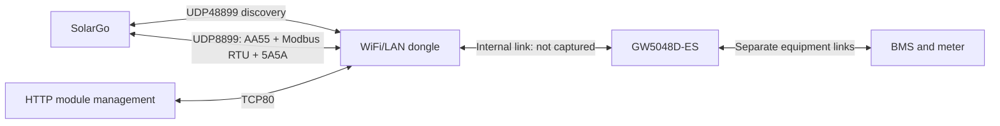

> Public evidence uses pseudonymous LAN addresses, MACs and device serials.
> Encoded identity bytes may also be substituted. Affected historical frames
> are unsuitable as checksum-valid replay fixtures. Private captures and WLAN
> credentials are excluded.

> Current implementation uses `/protocol/goodwe/client`, `/binding/goodwe` and
> `/protocol/goodwe/server`. The common watchdog and migration are documented in
> `COMPONENT_TEMPLATES.md` and `CLI.md`. Dated captures retain their original
> command names. `GOODWE_PROFILE_COVERAGE.md` distinguishes current implementation
> from hardware verification and incomplete configuration transactions.

# GoodWe local protocol and configuration reference

Revision: 2026-11-07, Australia/Brisbane.

## Record retention and completion

The core PR contains the protocol findings, source references, model-specific
surveys, sanitized observations, validation results, implementation and tests.
The paired profiles PR contains the executable ES and native configuration maps.
The core commit pins the required profiles submodule revision. Both PRs remain
drafts while the outstanding coverage and verification work is completed.

| Record | Durable location in the PR |
| --- | --- |
| Current implementation and confidence | [Coverage report](GOODWE_PROFILE_COVERAGE.md) and [machine-readable index](GOODWE_PROFILE_COVERAGE.json) |
| Legacy ES menus and configuration | [208-entry survey](GOODWE_SOLARGO_MENU_SURVEY.md) and its JSON companion |
| House native platform menus and configuration | [Native configuration reference](GOODWE_SPN_CONFIGURATION.md), [102 screen states](GOODWE_SPN_MENU_SURVEY.json) and [150 distinct requests](GOODWE_SPN_OBSERVED_REQUESTS.json) |
| Mode selector corrections | [ES source trace and hashes](GOODWE_LEGACY_MODE_ENCODINGS.json) |
| Latest proxy, configuration and alarm evidence | [Dated validation record](GOODWE_PROXY_VALIDATION_20261106.json) |
| Hardware recovery, watchdog and dispatch investigations | [Operational discovery](GOODWE_OPERATIONAL_DISCOVERY.md) and its linked dated records |
| Warning and duplicate-packet investigation | [Network diagnosis](GOODWE_PROXY_NETWORK_DIAGNOSIS.md) |
| Public references and their provenance | [Source catalogue](GOODWE_ECOSYSTEM_SOURCES.json) |
| Unfinished implementation and verification | [Repository work list](../TODO.md#goodwe-integrated-protocol-and-profile-follow-through) |

Raw packet captures, original screenshots, APK/decompiler files, credentials and
working scripts remain private local artifacts. The PR includes sanitized
observations and extracted findings, while independent retention of those private
artifacts remains to be arranged. Older notebooks still require reconciliation
against the current reference. A claim that every local observation has been
reconciled and independently archived would exceed the completed audit.

**Full configuration capability remains incomplete on both target devices.**
Outstanding work includes legacy battery catalogue/self-defined transactions,
remaining applicable model-specific workflows, standalone Device-backed server
write completion, and changed-value hardware acceptance, persistence and
communication-loss behavior. The known reserve reversion and hybrid dispatch
semantics remain open investigations. The survey counts describe the recorded
observations and provide no completeness percentage.

Native alarm count/cursor/window retrieval is implemented and exercised by
SolarGo against an isolated fixture. Its raw record fields are exposed in the
native profile. Physical alarm paging and runtime fault-catalogue resolution
remain on the work list.

The model-specific [native SPN configuration survey](GOODWE_SPN_CONFIGURATION.md)
records the current house menus, exact command parameters, conditional controls
and remaining implementation gaps. The historical ES material below is not a
substitute for that target-specific survey. The [ES mode workflow table](GOODWE_SOLARGO_MENU_SURVEY.md#implemented-esu-dsp23--arm14-mode-transactions)
records its implemented model/firmware-specific setup, selector encodings and reply codes.

This is the consolidated engineering reference for the **GW5048D-ES**, DSP23/23,
ARM14, communication-module firmware V1.1.3.14, and **SolarGo 7.2.2/build1521**.
The owner confirms that this installation communicates through its dongle and
has no accessible EMS port. The SBP-20 is a different device and protocol generation.

This document covers every identified surface: connection, framing, telemetry,
configuration, dispatch, schedules, module management, alarms, app behavior,
errors, implementation boundaries and conformance. An explicitly unresolved
operation is part of the reference, not a claim of support. Physical power
tracking, automatic hardware recovery and some write workflows remain unverified.
Neither public documents nor APK enumeration establishes every firmware command.

The [proxy warning investigation](GOODWE_PROXY_NETWORK_DIAGNOSIS.md) separates
the per-serial privacy reminder from duplicate UDP delivery on the tested VLAN3
path. Home and Battery Function loaded successfully through the same proxy over
an alternate network path; the source of the duplicates remains unidentified.

## Contents

1. [Which register maps to use](#which-register-maps-to-use)
2. [Connection and session](#connection-and-session)
3. [Wire formats](#wire-formats)
4. [Telemetry and field decoding](#telemetry-and-field-decoding)
5. [Configuration and operational commands](#configuration-and-operational-commands)
6. [External charge/discharge control](#external-chargedischarge-control)
7. [Battery reserves, selection and schedules](#battery-reserves-selection-and-schedules)
8. [Protection, grid support and power limits](#protection-grid-support-and-power-limits)
9. [Alarms and diagnostics](#alarms-and-diagnostics)
10. [Communication module](#communication-module)
11. [SolarGo screen coverage](#solargo-screen-coverage)
12. [OpenWatt implementation contract](#openwatt-implementation-contract)
13. [Evidence, limits and unresolved behavior](#evidence-limits-and-unresolved-behavior)
14. [Register, field and operation appendices](#appendix-a-reconciled-register-directory)
15. [App safety register map](#appendix-f-installed-app-safety-and-curve-register-map)
16. [Complete emulator request inventory](#appendix-g-every-distinct-request-in-the-emulator-pass)

## Which register maps to use

**There is no single correct map for all GoodWe inverters.** Select by controller
platform, inverter family, firmware and transport, then apply verified corrections.

| Reference | Appropriate use | Limit |
| --- | --- | --- |
| [GoodWe Modbus V1.3, 2017-11-10](https://downloads.vodnici.net/uploads/wpforo/attachments/483/4349-1GoodweModbusPROTOCOLHybrid-ENV1-3EMseries.pdf) | Legacy low-voltage hybrid settings; especially 056E/056F and table8-16 | Best control baseline for this target; old document contains label/range inconsistencies |
| [ARM105 LV V2.5, 2020-02-24](https://www.dth.net/solar/megarevo/monitoring/Goodwe_Modbus_Protocol_Hybrid__ARM105%20LV__v2.5_Read%20Only%2020200224.pdf) | ES/EM/SBP low-voltage telemetry, status and diagnostic definitions | Public edition omits the setting tables; changelog mentions more registers than the edition publishes |
| [ARM745 V1.2, 2024-02-02](https://devicelib.my-gekko.com/download_docu.php?ext=pdf&fname=GoodWe_ARM_745_Modbus_protocol_Map_ET50._ET30__ESG2_V1.2_20240202_1_.pdf&id_pk=753) | Later ET/ESG2 generation | Do not substitute for ARM105 legacy ES |
| [Third-party EMS V1.1.1](https://en.goodwe.com/Ftp/EN/Downloads/GW_Third-Party-EMS-Protocol_MODBUS-EN.pdf) | Explicitly listed later models, 42000/42001 and 47511/47512 control blocks | Legacy ES is not listed; these blocks failed reads on this target |
| [Pinned Python GoodWe implementation](https://github.com/marcelblijleven/goodwe/tree/66dfcdd9cd947bfd799f2bddb40b4e05ba9db6f6/goodwe) | AA55 offsets, carrier implementations, model/firmware gates and schedule formats | Independent implementation, not vendor authority; target-specific decoding conflicts exist |
| Installed SolarGo APK and captured exchanges | App-specific validation, field transforms, actual requests/ACKs | Includes multiple product generations; static presence is not target support |

The legacy map is corroborated on the real inverter: both reserve registers read
20%, and the legacy control pair accepted charge/discharge mode and watt values
with correct ACK and read-back. This supports those entries; it does not certify
every row of the manual. The read-only ARM105 map is a useful supplement rather
than a replacement for the missing configuration section.

Source versions, hashes, mirror provenance and retrieval limitations are in
[GOODWE_ECOSYSTEM_SOURCES.json](GOODWE_ECOSYSTEM_SOURCES.json).
Two downloaded mirrors had expired certificates; their transport was not
authenticated. The V1.3 PDF was readable through the web reader but direct
download returned HTTP403; no local PDF hash is claimed.

### Address and scale conventions

- Addresses in this document are **literal zero-based 16-bit wire addresses**.
  `0x056E = 1390`; send `05 6E`, not a decimal 4xxxx reference.
- The old repository transcription uses `40000 + address` for OpenWatt holding
  register notation. For example, profile reference41390 corresponds to wire1390.
  A separate tool using 40001-based human notation needs its own conversion.
- AA55 payload offsets are **bytes**, starting at the payload's first byte.
  They are not register addresses. A packed one-byte enum changes subsequent offsets.
- Register words and ordinary numeric fields are big-endian; CRC bytes are
  little-endian. Multiword values require the documented width and word order.
- A table's `RW` flag is a source claim, not evidence that this firmware accepts
  every value or transport. Never widen a U16 to U32 by borrowing another model's map.

### Reconciled errors and conflicts

| Conflict | Required interpretation |
| --- | --- |
| Legacy grid high/low voltage labels versus ranges at0002/0003 | Internally inconsistent; do not derive acceptance limits from these rows |
| Legacy S1/S2 safety names versus SolarGo Stage1/Stage2 | Match address, value and screen; names alone are insufficient |
| Old 47505 “manufacturer code” versus newer “EMS fallback mode” | Version/model-dependent meaning; no legacy ES fallback inference |
| Public library has no ES `set_ems_mode` implementation | Missing library support; not evidence the inverter lacks legacy056E/056F control |
| Python bulk charge/discharge current fields decoded as integers | ESU app applies additional conversion; see the following section |
| Old library 03/26→03/B6 and03/27→03/B7 versus app constants A6/A7 | Conflicting references; actual target ACKs for these commands remain to be captured |
| Nominal identity response64bytes versus target77bytes | Accept the verified77-byte form; preserve extension bytes until decoded |
| Reserved words, sentinels and missing data | Preserve distinction between unknown, unavailable, stale and numerical zero |

## Connection and session



The same IP/port serves inverter and communication-module operations. This is why
successful AA55 telemetry alone did not make the proxy fully compatible.

Discovery request: ASCII `WIFIKIT-214028-READ` to UDP48899. The reply is comma
delimited, containing an IP and module MAC/name-like identity. SolarGo uses the
reply packet's **source IP** for the subsequent connection. Advertising a payload
address does not replace correct routing, source address or LAN selection.
The real device is on192.168.3.x. Proxy identity must remain distinct from the
real inverter while its Device values can come from that inverter.

SolarGo successfully reads without AA55 registration in the captured sessions.
The optional AA55 address-registration flow is still a separate protocol surface:
00/00 query, 00/80 announcement, 00/01 address allocation including serial/address,
00/81 confirmation, 00/02 removal and00/82 confirmation. Do not require it for
the verified direct path. The target has responded from AA55 addresses0D and7F;
the client identifiers C0 andB0 both appear. Avoid an invariant source-address
assumption that rejects otherwise valid replies.

The installer login, address registration, module password policy and cloud
account login are distinct mechanisms. The app accepting an installer password
does not prove an authenticated session exists on the inverter's UDP endpoint.
Read and bounded dispatch writes here worked without a registration exchange.
No universal authorization model is inferred for other firmware or Bluetooth.

## Wire formats

Dispatch by a validated frame, not just UDP port or the first two bytes.

| Family | Layout | Validation |
| --- | --- | --- |
| Vendor AA55 | `AA55 SRC DST CONTROL FN LEN8 PAYLOAD SUM16_BE` | Total length=LEN+9; sum includes all bytes before checksum |
| Raw Modbus RTU request over UDP | `UNIT FN ADDRESS_BE ... CRC16_LE` | Modbus CRC over UNIT through data; no MBAP header |
| GoodWe Modbus reply | `AA55 UNIT FN ... CRC16_LE` | Strip prefix for CRC calculation; decode Modbus function/exception |
| Module v1 | `5A5A 01 FN LEN16_BE PAYLOAD CRC16_LE` | Total length=LEN+8; CRC includes5A5A prefix |
| Module v2 candidate | `5A5A 02 ...` | APK password-change branch; full session/layout not verified here |
| Modbus TCP | `MBAP UNIT PDU` | Different transport/framing, when supported and enabled; not RTU with a TCP socket |

CRC uses the Modbus reflected polynomial0xA001 and initial0xFFFF. In particular,
`AA55 F7 03 ...` is a Modbus reply, not a vendor AA55 frame with F7 as source.
Vendor AA55 control values observed/static include00 registration,01 read,
02 register/settings and03 execute;04 appears in app BMS-related commands.

### Register access carriers

| Operation | Carrier/body | Response |
| --- | --- | --- |
| Read N words | Modbus `F7 03 ADDRESS16 COUNT16 CRC` | Prefixed03, byte-count2N, data, CRC |
| Write one word | Modbus06 | Prefixed echo; alarm cursor verified, general setting behavior model-specific |
| Write multiple words | Modbus10, count, byte count, data | Prefixed address/count echo; legacy EMS pair verified |
| AA55 register read | control01/function1A, `ADDRESS16 COUNT8` | control01/function9A, raw word data |
| AA55 register write | control02/function39, `ADDRESS16 COUNT8 VALUES` | Reference expects02/B9; target reserve-write ACK not captured |

The single-word wrapper has a five-byte payload: address2, count1, value2.
The app's four-word schedule wrapper has an eleven-byte payload with count4 and
eight data bytes. The pinned library instead puts the data's byte length8 in
that position. This is an unresolved multiwrite conflict: neither interpretation
has been write-verified here. Do not build a universal multiwrite encoder from
the single-word evidence.

Examples from the real device:

```text
Read legacy mode/power:
  TX f703056e0002b18c
  RX aa55f70304000100003dfc
AA55 register read of the same pair:
  TX aa55b07f011a03056e0202c1
  RX aa550db0019a0400010000025c
AA55 reassert auto / 0 W:
  TX aa55b07f033a03010000026f
  RX aa550db003ba01060280
```

### Errors, retries and ownership

Captured Modbus exceptions include02 and04. An exception response is distinct
from a malformed packet, short success record or timeout. AA55 01/9A payload15
appeared for several rejected/unsatisfied reads; its complete meaning is unverified.
Do not decode it as a register value or manufacture a zero-filled record.

Several app paths retry three times, commonly using2-second module timeouts.
Do not apply one timeout to all operations: delayed BMS information was observed.
Neither UDP nor the vendor bulk frames provide an arbitrary transaction ID.
Correlation must include endpoint, carrier, unit/address/control/function and
expected shape, with bounded ownership of outstanding requests. If two operations
can produce indistinguishable responses, serialize them. An ACK is not read-back;
read-back is not measured hardware behavior.

## Telemetry and field decoding

Main bulk reads are01/02 identity→01/82,01/06 runtime→01/86, and01/09 settings→01/89.
The observed payload lengths include77,140 and86bytes respectively. These are
target observations rather than universal protocol constants. The old01/01
layout in the repository is not interchangeable with01/06.

Identity contains firmware string at0/5bytes, model at5/10, serial at31/16 and
ARM-related text at51/12 in the pinned implementation. Store raw extensions and
the original firmware string; deriving DSP/ARM versions is model-specific.

The full field directory is in AppendixB and
[GOODWE_AA55_FIELD_REFERENCE.json](GOODWE_AA55_FIELD_REFERENCE.json). Important
runtime byte offsets in01/86 are:

| Offset | Representation | Meaning / qualification |
| --- | --- | --- |
| 0/2,5/7 | U16×0.1 | PV1/PV2 voltage/current; mode bytes at4/9 |
| 10 | U16×0.1V | Battery voltage |
| 14,16,18 | statusU16, temperatureS16×0.1°C, currentU16×0.1A | Current magnitude; direction requires mode |
| 20,22 | U16 amperes | BMS charge/discharge current limits, distinct from configured limits |
| 24,26,29,30,31 | errorU16, SOCU8, SOHU8, modeU8, warningU16 | Do not collapse BMS status, battery mode and errors |
| 33,34,36,38,40,42 | meterstatusU8,V×0.1,A×0.1,powerS16W,frequency×0.01,gridmodeU8 | Grid direction also has byte80; define sign convention explicitly |
| 43,45,47,49,51 | backupV×0.1,backupA×0.1,ongridloadW,backupHz×0.01,loadmodeU8 | Offset47 is not the backup-power field |
| 52,53,55 | energy-modeU8,tempS16×0.1,errorbitmapU32 | Separate energy/work/grid mode domains |
| 59,63,67,69,71 | energyU32×0.1kWh,hoursU32,dayU16×0.1kWh,loaddayU16×0.1kWh,loadtotalU32×0.1kWh | Counter names differ in older maps; verify energy direction |
| 75,77,78,80,81 | totalpowerS16W,effective-modeU8,relayU16,grid-directionU8,backuppowerU16W | Marker established backup power at81 |
| 83,89 | powerfactor/1000,diagnosticbitmapU32 | Power-factor interpretation still needs reconciliation |

The reference library uses positive battery power for discharge and negative for
charge, deriving direction from battery mode. It derives house consumption from
PV, signed battery and signed grid power. That is a client convention, not a
signed battery-power word in01/86. Keep consumption derivation and meter location
explicit when binding a Device or comparing SolarGo.

### ESU bulk-current conversion: verified discrepancy

For this serial family SolarGo converts01/89 offset26 to `raw / 2.66 A` and
offset28 to `raw / 1.28 A`. Its internal conversion divides by0.266/0.128, then
the UI divides by10. The BPU/BHN branches differ. Marker37 displayed13.9A and
marker43 displayed33.6A, exactly matching these formulas.

Raw Modbus055D/055E instead use0.1A: a500 word represents50A. The observed bulk
133/64 pair also represents approximately50A after ESU conversion. A decoder
that maps AA55 bulk raw133 straight to133A is wrong for this target.
Read and write units need not be symmetric: app03/51 and03/52 builders send
physical tenths-of-an-ampere settings. See
[GOODWE_CURRENT_SCALING.json](GOODWE_CURRENT_SCALING.json).

## Configuration and operational commands

The following catalogue combines app constants, pinned implementation and target
wire evidence. `S` means static/reference only, `R` real read verified, `W` real
write ACK/read-back verified. A listed response is not a universal success schema.
In particular, only03/3A's06 success payload is established by our control trial.

| Request | Purpose / payload | Response and status |
| --- | --- | --- |
| 01/02 | Identity | 01/82, R |
| 01/06 | Runtime | 01/86, R |
| 01/09 | Bulk settings | 01/89, R |
| 01/1A | Register addressU16,countU8 | 01/9A, R for selected ranges |
| 01/1D | Country/standard information | 01/9D, R; full16-byte meaning incomplete |
| 01/25 | BMS/protocol information | 01/A5, R; not a universal BMS version command |
| 01/13 | Self-test data | 01/93, S |
| 02/39 | AddressU16,countU8,word data | 02/B9 per reference, S; off-grid setter request captured |
| 02/01 | App password-check envelope,16-byte payload beginning with role byte | S; authentication semantics not established |
| 02/03 | Login-failure information | S; do not assume safe because a factory is named Reading |
| 02/21 | Battery activation command/16-byte payload | S; firmware/model-dependent |
| 02/3A | Safety country/standard write in105 factory | S; distinct from execute03/3A |
| 02/46 | Battery SOC parameters,6bytes | S |
| 03/01 | Safety country selection | 03/81 per app, S |
| 03/02 | Six clock bytes | 03/82 per app, S; clock ACK trial did not resolve proxy Home warning |
| 03/1B,03/1C | Start/stop in older AA55 specification | S; not battery-dispatch controls |
| 03/1D | Reset/reconnect labels conflict across references | 03/9D, S; do not execute based on name alone |
| 03/1E | Active-generation percentage limit | 03/9E, S; not battery watt target |
| 03/1F | Power factor | 03/9F per app, S |
| 03/26 | Store-energy mode bit value | A6 app versus B6 library, S/conflict |
| 03/27 | Relay/off-charge bitfields,2bytes | A7 app versus B7 library, S/conflict |
| 03/28 | Shadow scan bitfields,2bytes | 03/A8 per app, S |
| 03/2A | Internal SCI switching | 03/AA, S; firmware-gated workflow, not normal client registration |
| 03/2C,03/2D | Charge/discharge start-hour,minute,end-hour,minute,percent | 03/AC,03/AD, S |
| 03/2E,03/2F,03/04 | BP-specific off-charge/PV-discharge/BMS options | AE/AF/84 app constants, S; not generic ES controls |
| 03/35 | Export limitU16 watts | 03/B5 per app, S |
| 03/36 | Off-grid work-mode selection | 03/B6 per app, S |
| 03/37 | Battery activation value | 03/B7 per app, S |
| 03/3A | External dispatch: modeU8,powerU16 watts | 03/BA,payload06, W for reasserted auto1/0W |
| 03/3B | SOC protection setting | 03/BB per app, S; inverse naming versus StopSocProtect register |
| 03/3C | AU safety parameters | S; complete payload/ACK not validated |
| 03/43 | Self-test control data | 03/C3 per app, S |
| 03/50 | Lead-acid capacity | 03/D0 per app, S |
| 03/51 | Charge voltageU16,currentU16; both physical×10 | 03/D1 per app, S |
| 03/52 | Discharge voltageU16,currentU16,minSOCU8 | 03/D2 per app, S; a reserve change can rewrite voltage/current |
| 03/56 | App branches for float parameters / battery-selection data | 03/D6 constant; payload/model disambiguation required |
| 03/57 | Maintenance/equalization parameters | 03/D7 per app, S |
| 03/59 | General/offgrid/backup/Eco app-mode selector | 03/D9 per app, S; separate from legacy EMS mode |
| 03/5B | Grid-wave/sensitivity/backup-detection setting | 03/DB per app, S |
| 03/5E | Clear overload/reconnection history | 03/DE per app, S; command affects state, not telemetry |
| 03/62 | BKU battery-parameter payload | S, other105 variant |
| 03/63 | Restart magicBB44 | S; found inside a Reading factory |
| 04/01,04/02,04/03 | App BMS-related request families | 04/81,82,83 constants; applicability/transport not validated |

All identified platform105 register-read and register-write factory cases are
listed in AppendixC, including region/BKU variants. The larger all-model index
contains1,083 switch cases and1,138 direct register call sites in
[GOODWE_SOLARGO_FACTORY_INDEX.json](GOODWE_SOLARGO_FACTORY_INDEX.json).
The count is a discovery index, not1,083 supported commands. It omits dynamic
behavior that cannot be reconstructed from the inspected decompilation.

## External charge/discharge control

Use the **legacy pair056E/056F** for this target. Both words are U16. Mode and
power can be written together using Modbus10; AA55 execute03/3A packs a one-byte
mode and two-byte power. Keep this register schema separate from modern EMS
mode11/12 APIs, whose semantics are not proven on this device.

| Legacy mode | Intent | Power interpretation | Target validation |
| --- | --- | --- | --- |
| 1 | Automatic meter-based operation | Baseline0 | ACK/read-back via Modbus and AA55 |
| 2 | Charge, PV preferred | Maximum allowed grid contribution inW;0 means PV-only per source | 123W accepted/read back via Modbus; actual power not measured |
| 3 | Discharge | Maximum discharge power inW | 137W accepted/read back via Modbus; actual power not measured |
| 4 | Grid import scheduling | Grid-power target, PV can be curtailed | Documented; not tested |
| 5 | Grid export scheduling | Grid-output target, PV before battery | Documented; not tested |
| 6 | Conserve | Source says power field irrelevant; charge on grid, discharge off grid | Documented; not tested |
| 7 | Forced off-grid | Disconnect from grid | Documented; not tested |
| 255 | Stopped | Source specifies0 | Documented; not tested |

The old manual lists power0–4600W. Later evening trials confirmed +/-4600 W
commands and physical power in both directions, although negative power did not
reach the full ceiling. +/-5000 W settings also read back, while +/-7000 W
attempts failed. Do not infer exact tracking from the model name or settings
readback. Modern mode8 battery standby is not established for this legacy pair.

Exact verified writes and read-back:

```text
Charge limit123W:
  TX f710056e0002040002007bb733
  RX aa55f710056e0002344f
  read-back aa55f703040002007b8ddf
Discharge limit137W:
  TX f710056e000204000300896776
  RX aa55f710056e0002344f
  read-back aa55f70304000300895d9a
Restore automatic / 0W:
  TX f710056e000204000100000710
  RX aa55f710056e0002344f
  read-back aa55f70304000100003dfc
```

These initial tests changed control settings briefly and restored the exact baseline;
physical validation came later. The requested exact battery
power can differ from a grid contribution or maximum, especially when PV or
loads change. Communication-loss fallback, required refresh cadence, restart
persistence, mode precedence and zero-power hold remain explicit conformance gaps.
The newer map's30-second fallback and1-second write cycle must not be silently
assigned to this ES. Management control needs observed actual power, read-back,
an explicit restore path and failure handling before it can claim those guarantees.

## Battery reserves, selection and schedules

### Reserves and DoD

Wire values are **minimum SOC**. `DoD = 100 - minimum_SOC`; the user's on-grid
goal minimumSOC20% corresponds to DoD80%. Zero minimum SOC is not a missing value.

| Operation | Address / command | Status |
| --- | --- | --- |
| On-grid minimum SOC | 0560,U16%; also01/89 offset32 | Both read20 on real device |
| Off-grid minimum SOC | 05A1,U16%; AA55 read01/1A | Both carriers read20 |
| Off-grid undervoltage + reserve | 05A0/2, app02/39 | Static coupled write, not tested |
| On-grid write via app | 03/52 also rewrites discharge voltage/current | Static path; actual reserve-write ACK/persistence unverified |
| Alternate on-grid write | 02/39 at0560; reference library uses this | Static/reference; target write not validated |
| Off-grid write via app | 02/39 at05A1 | DoD79 request captured and withheld from real device |

The captured DoD79 frame is `aa55b07f02390505a1010015032a`: raw21% minimum SOC.
The selected PYLONTECH US2000B-TB*2 profile (index123/protocol12) limits SolarGo
to80% DoD. Its off-grid95% input showed`Range[0,80]` and generated no request.
This is an app-profile restriction, not an established firmware rejection.

The reported reserve reversion is not reproduced. Both current reads were20;
there is no evidence yet of the bad value, its writer or its timing. Correlate
both raw reserves with selection/protocol, work/EMS modes, clock, resets,
configured current/voltage limits, BMS limits and diagnostic bits. Do not keep
rewriting a reserve blindly or infer its value from a cached app screen.

### Battery selection and parameter dependencies

Battery brand/model is an app/profile interpretation, not necessarily an ASCII
string returned by the inverter. Index0566 and protocol05A3 are separate concepts;
01/25 returned`0001 000C` on this device. App03/56/other105 settings may bundle
selection and parameters. The presence of named defaults in an app asset does
not establish the actual current inverter setting.

Runtime BMS limits at01/86 offsets20/22 are different from configured current
limits. The Battery Function charge/discharge display, SOC protection, reserve
and immediate-charge data also arrive through different requests. One failure
can leave a partially populated screen with old values.

### Immediate charging and schedules

F7/03 B9B9/2 (decimal47545/2) returned switch0 and targetSOC100. This real
read populated Battery Function. Reference code gates the typed “fast charging”
feature at ARM19; this ARM14 answered the read, which does not prove writes work.

Eco-v1 groups start0701/0705/0709/070D, four words each; switch words are
0704/0708/070C/0710. Register0700 is the app/reference clear-parameter command.
Eco-v2 groups start47547/47553/47559/47565, six words each; their switch bytes
are in47549/47555/47561/47567. Raw reads of all four v2 groups succeeded here.

Reference v1 record: start-hour,minute,end-hour,minute,S16signed-percent,
enable-byte,weekday-mask. V2 record: start/end four bytes,enable/type byte,
weekday-mask,S16power,S16SOC,S16month-mask/reserved. Negative power represents
charge and positive discharge in the referenced Eco format. Type and firmware
determine units; do not copy that signed percentage interpretation to EMS056F.

The pinned implementation enables v2 for ARM>=14 with additional serial/DSP gates;
this ESU/DSP23 satisfies its ES threshold>=22. Its forced Eco charge/discharge
replaces group1 with a full-day entry, disables other groups and selects Eco.
That modifies schedules and is not an instantaneous dispatch primitive. The
legacy EMS pair is the more direct verified settings path for this installation.

## Protection, grid support and power limits

The legacy register directory covers active/reactive limits, backup enable,
PV shadow scan, export enable/limit, battery voltage/current protection,
SOC protection, detection sensitivity, staged voltage/frequency protection,
reconnection conditions, response curves and meter checks. Source access flags
and ranges are not enough to authorize one generic writable-register API.

| Surface | Source/field group | Qualification |
| --- | --- | --- |
| Generation ceiling | 0100 percentage /03/1E | Inverter output ceiling, not battery EMS power |
| Export enable and watts | 0559/0567;03/53 and03/35 | Feed-enable polarity differs by naming; preserve original raw semantics |
| Backup supply | 0556; bulk01/89 offset12 | Enable state differs from measured backup power/availability |
| Shadow scan | 0558;03/28 bitfields | Do not encode a boolean directly into an unverified two-byte bitfield |
| Power factor | 0101/0562 and03/1F | Old encodings differ; sign/scale and curve precedence need target testing |
| SOC protection | 0569 /03/3B | StopSocProtect name has inverse polarity to a UI protection switch |
| Battery wake/activation | 0561,056A,03/37,02/21 | Distinct period, DC output and command surfaces |
| Detection/grid-wave sensitivity | 0575 /03/5B | App uses values for backup/detection semantics; region/firmware conditional |
| Country/standard | 0599,01/1D,03/01,02/3A | Country code and standard revision are separate fields |
| Voltage/frequency thresholds | 0578–058E plus7100+ self-test data | S1/S2 label conflict must be resolved per address and UI |
| Q(U),P(U),cosφ(P),frequency response | 058F–0598 and newer raw Modbus blocks | Product/region-specific; a successful block read is not complete curve decoding |
| Meter/CT test and status | 059C/059D and B7A7 | Test initiates state; status values are not ordinary booleans |

Captured SolarGo safety reads include F7/B158/17,B169/16,B253/33,B179/66,
B1C8/1 andB183/67. The installed app's `CustomSaftyParamEnum` supplies explicit
addresses, request prefixes, types, unit/gain hints and input ranges for these
screens, including Protection, Connection, Curves and Other. The full static
directory is in [GOODWE_APP_SAFETY_MAP.json](GOODWE_APP_SAFETY_MAP.json) and
Appendix F. Every setting row uses a function06 prefix, but actual write ACKs
and firmware acceptance have not been tested. Embedded app defaults are omitted:
they are not inverter data.

The protection bank45400–45416 is17U16 words: OV1,time,UV1,time,OV2,time,UV2,time,
10-minute voltage,OF1,time,UF1,time,OF2,time,UF2,time. Voltage is raw/10V and
frequency raw/100Hz. Time is periods: raw/50seconds at nominal50Hz or raw/60
at60Hz. The enum's gain-hint2 must not be interpreted as division by2. The target
values2650/75 match265.0V/1.50s in the real app.

B253/33 provides an optional66-byte extended-time record. Its firstU16 must have
bit0 set and must not equalFFFF before the app uses the U32 millisecond values.
The target returned allFFFF, so period timing remains in use. The static offsets
for the extended record are retained in the safety-map artifact; simply decoding
FFFF as a large configured duration would be wrong.

The connection bank45417–45432 includes voltage/frequency limits, waiting times
and slope controls. Its observed2540/1960/5015/4750/60 values match the real
app's254V/196V/50.15Hz/47.50Hz/60s. Shared higher addresses therefore work on
this legacy target even though newer EMS42000/47511 blocks do not. Compatibility
must be decided per block, not by rejecting or accepting an entire generation.
Negative curve ranges alongside an enum typeU16 and several dubious unit labels
remain source inconsistencies; use the actual parser/encoder path to resolve them.
No grid-protection setting was changed in the investigation.

## Alarms and diagnostics

History uses a stateful **page cursor**, not just a stateless read:

1. Read D6D8/67 (134payload bytes) for current history/page information.
2. Write B7A8 with the requested page via Modbus06.
3. Require the prefixed06 echo, then read D6D8/67 again.

SolarGo used pages45 then44. The captured page45 request
`f706b7a8002dfb15` was ACKed by`aa55f706b7a8002dfb15`; entries then appeared.
The first blank screen in the emulator pass followed the harness withholding the
cursor write. That observation is not proof of an inverter alarm failure.

The working block interpretation is a two-byte header, eight16-byte records,
then four trailing bytes. Within each record: unknown prefix2,timestamp4,code4,
type1,state1,unknown1,temperature1,ID2. Three timestamps matched the app when
rendered as Unix seconds without adding10hours; inverter timezone semantics
remain unproven. Header count/capacity semantics, rollover/end behavior, record ordering,
remaining flag meanings and invalid-record rules are not fully established.
Preserve raw records and page metadata. Temperature-looking small values in
alarms must not be assumed to be current live battery temperature.

Runtime diagnosis is a separate bitmap at01/86 offset89, corresponding to
legacy0532/0533. Relevant bits include SOC low1, BMS discharge disabled3,
charge/discharge schedule4/5, EMS current zero12, battery disconnected14,
charge disabled18, self-use off19, off-grid SOC low22 and protection flags24–28.
Use the versioned enum; identical labels do not make BMS alarm, warning and
inverter diagnostic codes interchangeable.

## Communication module

The module has its own firmware, network configuration, credentials, diagnostics
and update/reload state. It is not completely represented by inverter Modbus.

| v1 function | Meaning in app/capture | Target status |
| --- | --- | --- |
| 01→81 | Module version; UTF-8 length-delimited response | R, V1.1.3.14 matches HTTP |
| 02→82 | Station network/security information | R; three byte-length-prefixed fields, including credentials |
| 03→83 | IP configuration | R; ASCII DHCP/static flag,IP,mask,gateway,DNS |
| 04 | Diagnostic branches with payload01/02 | Captured, withheld; effects/actual response unknown |
| 06 | App module-read branch | Static/captured; complete payload semantics not established |
| 07 | Hold branch, literal header declares length5 | Static; full exchange/body handling needs reconstruction |
| 08 | Release/unhold branch | Static; not tested |
| 09 | Heartbeat branch | Static; relationship to inverter session not established |
| 0A | Module password setting | Static; not tested |
| 0B | Module network configuration | Static; full compound workflow/ACK not tested |
| 0C | Module reload | Static; state-changing, not tested |
| 0D | Diagnostic command | Captured empty request, withheld; semantics unknown |
| 0E | Module availability read | Captured; bounded probe timed out, not proof unsupported |
| 5A5A v2/01 | Password-change branch in app | Static; do not treat as v1 function01/version read |

Verified module-version exchange:
`5a5a0101000004d0` → `5a5a0181000956312e312e332e3134a199`.
Network function03 returns comma-separated ASCII. Function02 is not that format:
it returned37payload bytes with field lengths11,12,11; its security descriptor
was`WPA2PSK,AES`. Credential-bearing responses are retained privately.

HTTP TCP80 responded with Basic authentication; authenticated read-only status
reported V1.1.3.14. No form submission, module upgrade or reset was performed.
Exact hardware/module part number remains unknown. TCP502 was refused in the
point-in-time check; RTU-over-UDP still worked. Later models may support enabled
Modbus TCP and Bluetooth, but that does not describe this dongle automatically.

The wider cloud/account API, logger upload, Bluetooth commissioning, battery CAN,
meter RS485 and upgrade protocols are separate planes. Known public references
are indexed in [GOODWE_ECOSYSTEM.md](GOODWE_ECOSYSTEM.md). HK1000 TCP/20001/cloud
research is not a specification for this ES's module upload protocol. No claim
of byte-level completeness is made for planes not captured on this installation.

## SolarGo screen coverage

| Screen/action | Protocol/data source | Discovery result |
| --- | --- | --- |
| Device search/connect | UDP48899,identity01/02,module version | Direct connection works; optional registration not needed |
| Password reminder | App policy/preferences/module classification | Also occurs on real device; does not establish unset password |
| Home | Runtime01/06 plus settings/identity/auxiliary reads | Markers established main electrical values; proxy-only WLAN error unresolved |
| Parameters→Data | Runtime,identity,battery profile/status | Partial assignments can survive a later failed request |
| Parameters→Alarm | D6D8 read + B7A8 cursor write | Pagination workflow and real ACK established |
| Settings→Communications→WLAN/LAN | 5A5A01/02/03 and setting branches | Real page populated; proxy module metadata alone did not resolve parity |
| Communications diagnostics | 5A5A04/0D and related status | Read paths traced:04 server state,05 counters,0D router credentials; real relay diagnosis completed |
| Basic→grid code/battery/work mode | Country,selection and composite execute/register workflows | Static branches indexed; complete selection writes not validated |
| Advanced→DRED,limits,shadow,backup/detection | Legacy bits + execute commands + regional register blocks | Read/static coverage; independent setting write/ACK tests remain |
| Advanced→power factor/output power | 03/1F,03/1E or raw register paths | Actual selected branch depends on model/region; do not conflate with EMS |
| Advanced→Battery Function | Bulk01/09,05A1,B9B9,current transforms,profile limits | Mixed sources mapped; reserve reversion and failed-fetch causal path unresolved |
| Advanced→Safety→Protection | 45400/17 plus optional extended timings and057x alternatives | App subfields/scales mapped, real reads/UI match; write workflows unverified |
| Safety→Connection/Curves/Other | Reconnection/curve/LVRT/HVRT blocks | Full113 app descriptors indexed; type/unit conflicts and write effects unverified |
| Meter function/check | CT test/status registers | Read/static factory mapped; test state-machine not exercised |
| Device information | IdentityDSP/ARM plus auxiliary BMS fetch | BMS read0780 follows battery serial90C4; failed read falls back to00;7506 is Hardware Power Limit |
| Device upgrade/update record | App upgrade factories,firmware metadata/cloud file selection | Indexed only; upload/recovery/session not validated; no upgrade performed |
| Installer login | App role/password path | Distinct from AA55 registration and module password |
| External EMS dispatch | Legacy056E/056F or03/3A | Verified programmatic settings path; need not appear in this model's app menus |

The Home “Cannot connect to WLAN module” wording is not a reliable transport
diagnosis. Static Home handling can report it after runtime parsing/assignment
fails. The privacy reminder is gated by app policy and saved serial/module
classification; it does not directly inspect an inverter password-status word.
These are separate errors. Battery Function “Failed To Retrieve Data” can also
coexist with populated cached/subset fields. Record successful reads per field.

## OpenWatt implementation contract

The desired architecture is a transport/session client and server with a shared
protocol-to-Device binding. One Device can be populated from the real inverter
and served to SolarGo under a distinct proxy identity. A captured raw reply,
synthetic success byte or static baseline is not a Device-backed implementation.

Required boundaries:

1. A frame dispatcher distinguishes vendor AA55, raw/prefixed Modbus and module
   v1/v2 candidates, logging every datagram before decode, including invalid data.
2. Operation descriptors include request payload, expected response shape,
   parameter address/count, model gate, decode/encode units, timeout, effects and
   read-back. Grouping only by AA55 function cannot represent different1A reads.
3. Bindings expose raw reserve/state plus normalized physical values, freshness
   and validity. Inverter values and local module metadata have separate owners.
4. Setting writes translate to verified operations and update the Device only
   after ACK/read-back. Failure, timeout and indeterminate outcome remain visible.
5. Server writes cannot return success without applying the local model or
   executing a configured upstream operation. Alarm cursor state is per client.
6. Live proxy serving preserves raw reserved/extension bytes where required;
   encoded field overlays use the correct record/carrier and ESU current scaling.
7. Dispatch control separates intent,accepted setpoint and measured power; it
   defines the actual restore/fallback contract rather than borrowing a newer one.

Current code has generic/manual client requests, raw capture/reply/relay tools and
a profile-driven server. The server still inherits ProfileBinding, parameterized
register sampling is incomplete, configuration is not fully bound bidirectionally,
and several app replies are research snapshots. Discovery coverage and runtime
implementation coverage must be reported separately. CLI details are in
[GOODWE_SERVER.md](GOODWE_SERVER.md) and [CLI.md](CLI.md).

## Live menu survey

The [SolarGo menu survey](GOODWE_SOLARGO_MENU_SURVEY.md) records the actual target UI walkthrough, individual read/write mappings, conditional branches and corrected BMS/module interpretations. Its [JSON companion](GOODWE_SOLARGO_MENU_SURVEY.json) contains source and capture evidence hashes. Menu coverage is separate from accepted hardware-write verification.

## Evidence, limits and unresolved behavior

| Evidence | Scope |
| --- | --- |
| [Native capture](GOODWE_NATIVE_LAN_CAPTURE_01.json) | Broad physical-LAN RPCAP; historical phone sessions, accounting gap recorded |
| [Emulator capture](GOODWE_EMULATOR_CAPTURE_20261029.json) | 267app requests/33distinct datagrams;508UDP8899 frames in WiFi checkpoint |
| [Thirty-read probe](GOODWE_FULL_READ_PROBE_20261029.json) | 17data records,4short AA55 replies,4Modbus exceptions,5timeouts |
| [Legacy EMS reads](GOODWE_LEGACY_EMS_PROBE_20261029.json) | Eight read exchanges, two carriers and raw/bulk settings comparison |
| [Modbus baseline write](GOODWE_LEGACY_EMS_REASSERT_20261029.json) | Exact auto1/0W ACK/read-back |
| [AA55 baseline write](GOODWE_LEGACY_AA55_EMS_REASSERT_20261029.json) | 03/3A→03/BA/06 plus unchanged register pair |
| [Control trial](GOODWE_LEGACY_EMS_CONTROL_TRIAL_20261029.json) | Charge2/123W,discharge3/137W,verified restore toauto1/0W |
| [Marker calibration](GOODWE_MARKER_BATCH_01.json) | Synthetic proxy-only field changes and user screenshot/report results |
| [Current reconciliation](GOODWE_CURRENT_SCALING.json) | ESU transforms explain two otherwise inconsistent marker values |
| [App static evidence](GOODWE_SOLARGO_722_STATIC.md) | Pinned APK/version/hash;457jadx errors limit completeness |

WiFi capture required Android WiFiPacketStream/netsimd; emulator Ethernet capture
alone missed its WiFi. Historical logs/captures do not prove every past packet was
saved. Exact raw credential-bearing artifacts remain private. Uncorrelated
response candidates in an interaction report are not promoted to verified ACKs.

The remaining empirical gaps are: physical EMS power behavior and fallback;
reserve reversion/persistence and actual reserve setter ACKs; Home proxy failure;
physical BMS-version response (app timeout fallback is now traced); alarm record/header edge cases; regional safety/curve
signedness, enable enums and optional branches; module diagnostic,setting and upgrade transactions; untouched network,
Bluetooth,cloud and internal-equipment planes. Each is tracked in [TODO.md](../TODO.md).
The document is a consolidated account of the identified surface, not a statement
that these gaps have been experimentally closed.

## Appendix A: reconciled register directory

This directory contains174 base/extension entries, including146 entries from the
existing V1.3 transcription. `W` means the complete EMS write ACK/read-back was
verified; `R` means the word is covered by a valid real read block, not that its
meaning has been independently calibrated; `S` means app-only/static candidate;
`D` means documented/transcribed only. There are78 read-covered entries and two
write-verified entries. A question mark is intentionally unresolved.

The legacy type/access/unit columns retain source claims. `strN` is the old
transcription's N-register ASCII notation; `i16` means signed16. `recordN` is a
multiword record, not a scalar. Application-derived regional entries can overlap
an older address with different labels. Use source notes and the main text before
choosing a setting. This is a research directory, not a write allowlist.

| Wire hex | Decimal | Field identifier | Type | Declared access | Raw unit | Evidence |
| --- | --- | --- | --- | --- | --- | --- |
| 0000 | 0 | pv_minimum_start_voltage | u16 | RW | 0.1V | D |
| 0001 | 1 | reconnect_time | u16 | RW | s | R |
| 0002 | 2 | grid_voltage_high_label_disputed | u16 | RW | 0.1V | D |
| 0003 | 3 | grid_voltage_low_label_disputed | u16 | RW | 0.1V | D |
| 0004 | 4 | grid_frequency_high | u16 | RW | 0.01Hz | D |
| 0005 | 5 | grid_frequency_low | u16 | RW | 0.01Hz | D |
| 0010 | 16 | rtc_year_month | u16 | RW | — | D |
| 0011 | 17 | rtc_day_hour | u16 | RW | — | D |
| 0012 | 18 | rtc_minute_second | u16 | RW | — | D |
| 0100 | 256 | active_power_limit_percent | u16 | W | % | R |
| 0101 | 257 | reactive_power_adjustment | u16 | W | — | D |
| 0200 | 512 | inverter_serial | str8 | R | — | D |
| 0210 | 528 | inverter_model | str5 | R | — | D |
| 0500 | 1280 | Vpv1 | u16 | R | 0.1V | D |
| 0501 | 1281 | Ipv1 | u16 | R | 0.1A | D |
| 0502 | 1282 | PV1 Mode | u16 | R | — | D |
| 0503 | 1283 | Vpv2 | u16 | R | 0.1V | D |
| 0504 | 1284 | Ipv2 | u16 | R | 0.1A | D |
| 0505 | 1285 | PV2 Mode | u16 | R | — | D |
| 0506 | 1286 | Vbattery1 | u16 | R | 0.1V | D |
| 0508 | 1288 | BMS Status | u16 | R | — | D |
| 0509 | 1289 | bms_temperature | u16 | R | 0.1°C | D |
| 050A | 1290 | Ibattery1 | u16 | R | 0.1A | D |
| 050B | 1291 | bms_charge_current_limit | u16 | R | 1A | D |
| 050C | 1292 | bms_discharge_current_limit | u16 | R | 1A | D |
| 050D | 1293 | bms_error | u16 | R | — | D |
| 050E | 1294 | SOC | u16 | R | % | D |
| 050F | 1295 | ES Warning | u16 | R | — | D |
| 0511 | 1297 | BMS SOH | u16 | R | % | D |
| 0512 | 1298 | Battary1 Mode | u16 | R | — | D |
| 0513 | 1299 | BMS Warning Code | u32 | R | — | D |
| 0515 | 1301 | Meter Status | u16 | R | — | D |
| 0516 | 1302 | Vgrid | u16 | R | 0.1V | D |
| 0517 | 1303 | Igrid | u16 | R | 0.1A | D |
| 0518 | 1304 | Pgrid | i16 | R | W | D |
| 0519 | 1305 | Fgrid | u16 | R | 0.01Hz | D |
| 051A | 1306 | Grid Mode | u16 | R | — | D |
| 051B | 1307 | Vload | u16 | R | 0.1V | D |
| 051C | 1308 | Iload | u16 | R | 0.1A | D |
| 051D | 1309 | Pload | u16 | R | W | D |
| 051E | 1310 | Fload | u16 | R | 0.01Hz | D |
| 051F | 1311 | Load Mode | u16 | R | — | D |
| 0520 | 1312 | Work Mode | u16 | R | — | D |
| 0521 | 1313 | Temperature | u16 | R | 0.1°C | D |
| 0522 | 1314 | Error Message | u32 | R | — | D |
| 0524 | 1316 | E-Total | u32 | R | 0.1kWh | D |
| 0526 | 1318 | h-Total | u32 | R | h | D |
| 0528 | 1320 | E-Day | u16 | R | 0.1kWh | D |
| 0529 | 1321 | E-Load-Day | u16 | R | 0.1kWh | D |
| 052A | 1322 | E-Total-Load | u32 | R | 0.1kWh | D |
| 052C | 1324 | TotalPower | i16 | R | W | D |
| 052F | 1327 | Grid in-out flag | u16 | R | — | D |
| 0530 | 1328 | Back-Up Load | u16 | R | W | D |
| 0531 | 1329 | MeterPowerFactor | u16 | R | % | D |
| 0532 | 1330 | DiagStatus | u32 | R | — | D |
| 0534 | 1332 | DRMStatus | u16 | R | — | D |
| 0535 | 1333 | E-Total-Sell | f32 | R | — | D |
| 0537 | 1335 | E-Total-Buy | f32 | R | — | D |
| 0539 | 1337 | Vpv3 | u16 | R | 0.1V | D |
| 053A | 1338 | Ipv3 | u16 | R | 0.1A | D |
| 053B | 1339 | PV3 Mode | u16 | R | — | D |
| 053C | 1340 | VgridUo | u16 | R | 0.1V | D |
| 053D | 1341 | IgridUo | u16 | R | 0.1A | D |
| 053E | 1342 | VgridWo | u16 | R | 0.1V | D |
| 053F | 1343 | IgridWo | u16 | R | 0.1A | D |
| 0540 | 1344 | E-BatteryCharge | u32 | R | 0.1kWh | D |
| 0542 | 1346 | E-BatteryDischarge | u32 | R | 0.1kWh | D |
| 0550 | 1360 | ChargerTimeStart | u16 | RW | — | R |
| 0551 | 1361 | ChargerTimeEnd | u16 | RW | — | R |
| 0552 | 1362 | BatChargePowerMax | u16 | RW | % | R |
| 0553 | 1363 | DisChargerTimeStart | u16 | RW | — | R |
| 0554 | 1364 | DisChargerTimeEnd | u16 | RW | — | R |
| 0555 | 1365 | BatDisPowerSet | u16 | RW | % | R |
| 0556 | 1366 | BackUpEnable | u16 | RW | — | R |
| 0557 | 1367 | OffGridAutoCharge | u16 | R | — | R |
| 0558 | 1368 | EnableMPPT4Shadow | u16 | RW | — | R |
| 0559 | 1369 | FeedPowerEnable | u16 | RW | — | R |
| 055A | 1370 | ManufacturerCode | u16 | R | — | R |
| 055B | 1371 | LeadBatCapacity | u16 | RW | Ah | R |
| 055C | 1372 | BattChargeVoltMax | u16 | RW | 0.1V | R |
| 055D | 1373 | BattChargeCurrMax | u16 | RW | 0.1A | R |
| 055E | 1374 | BattDisChgCurrMax | u16 | RW | 0.1A | R |
| 055F | 1375 | BattVoltUnderMin | u16 | RW | 0.1V | R |
| 0560 | 1376 | BattSOCUnderMin | u16 | RW | % | R |
| 0561 | 1377 | BatActivePeriod | u16 | RW | min | R |
| 0562 | 1378 | RPControlPara | u16 | RW | — | R |
| 0563 | 1379 | BattFloatVolt | u16 | RW | 0.1V | R |
| 0564 | 1380 | BattFloatCurr | u16 | RW | 0.1A | R |
| 0565 | 1381 | BattToFloatTime | u16 | RW | min | R |
| 0566 | 1382 | BattTypeIndex | u16 | R | — | R |
| 0567 | 1383 | FeedPowerPara | u16 | RW | W | R |
| 0568 | 1384 | AutoStartBackup | u16 | RW | — | R |
| 0569 | 1385 | StopSocProtect | u16 | RW | — | R |
| 056A | 1386 | DCVoltOutput/KeepBattVoltOn | u16 | RW | — | R |
| 056B | 1387 | BattAvgChgVolt | u16 | RW | 0.1V | R |
| 056C | 1388 | BatAvgChgHours | u16 | RW | h | R |
| 056D | 1389 | AS477Parameters | u16 | R | — | R |
| 056E | 1390 | WgPowerMode | u16 | RW | — | W |
| 056F | 1391 | WgPowerSet | u16 | RW | W | W |
| 0570 | 1392 | Reserved | u16 | R | — | R |
| 0571 | 1393 | NoGridChargeEnable | u16 | R | — | R |
| 0572 | 1394 | DisChgWithPVEnable | u16 | R | — | R |
| 0573 | 1395 | Reserved | u16 | R | — | R |
| 0574 | 1396 | AppModeIndex | u16 | RW | — | R |
| 0575 | 1397 | GridWaveCheckLevel | u16 | RW | — | D |
| 0576 | 1398 | MeterCheckValue | u16 | RW | 1W | D |
| 0577 | 1399 | RapaidCutOff | u16 | RW | — | D |
| 0578 | 1400 | GridVoltQualit | u16 | RW | 0.1V | D |
| 0579 | 1401 | GridVoltHighS2 | u16 | RW | 0.1V | R |
| 057A | 1402 | GridVoltLowS2 | u16 | RW | 0.1V | R |
| 057B | 1403 | GridVoltHighS2Time | u16 | RW | 0.02s | R |
| 057C | 1404 | GridVoltLowS2Time | u16 | RW | 0.02s | R |
| 057D | 1405 | GridVoltHighS1 | u16 | RW | 0.1V | R |
| 057E | 1406 | GridVoltLowS1 | u16 | RW | 0.1V | R |
| 057F | 1407 | GridVoltHighS1Time | u16 | RW | 0.02s | R |
| 0580 | 1408 | GridVoltLowS1Time | u16 | RW | 0.02s | R |
| 0581 | 1409 | GridFreqHighS2 | u16 | RW | 0.01Hz | R |
| 0582 | 1410 | GridFreqLowS2 | u16 | RW | 0.01Hz | R |
| 0583 | 1411 | GridFreqHighS2Time | u16 | RW | 0.02s | R |
| 0584 | 1412 | GridFreqLowS2Time | u16 | RW | 0.02s | R |
| 0585 | 1413 | GridFreqHighS1 | u16 | RW | 0.01Hz | R |
| 0586 | 1414 | GridFreqLowS1 | u16 | RW | 0.01Hz | R |
| 0587 | 1415 | GridFreqHighS1Time | u16 | RW | 0.02s | R |
| 0588 | 1416 | GridFreqLowS1Time | u16 | RW | 0.02s | R |
| 0589 | 1417 | GridVoltRecoverHigh | u16 | RW | 0.1V | D |
| 058A | 1418 | GridVoltRecoverLow | u16 | RW | 0.1V | D |
| 058B | 1419 | GridVoltRecoverTime | u16 | RW | 0.02s | D |
| 058C | 1420 | GridFreqRecoverHigh | u16 | RW | 0.01Hz | D |
| 058D | 1421 | GridFreqRecoverLow | u16 | RW | 0.01Hz | D |
| 058E | 1422 | GridFreqRecoverTime | u16 | RW | 0.02s | D |
| 058F | 1423 | PointBValue | u16 | RW | % | D |
| 0590 | 1424 | PointCValue | u16 | RW | % | D |
| 0591 | 1425 | GridLimitByVolStartVol | u16 | RW | 0.1V | R |
| 0592 | 1426 | GridLimitByVolStartPer | u16 | RW | % | R |
| 0593 | 1427 | GridLimitByVolSlope | u16 | RW | %/V | R |
| 0594 | 1428 | ActiveCurveVolt | u16 | RW | 0.1V | R |
| 0595 | 1429 | DesactiveCurveVolt | u16 | RW | 0.1V | D |
| 0596 | 1430 | EnableCurve | u16 | RW | — | D |
| 0597 | 1431 | BackupStartDly | u16 | RW | min | D |
| 0598 | 1432 | RecoverTimeEE | u16 | RW | %/min | D |
| 0599 | 1433 | SafetyCountry | u16 | R | — | D |
| 059A | 1434 | Iso Limit | u16 | R | 10kΩ | D |
| 059B | 1435 | BatBMSCurrLmtCoff | u16 | R | % | D |
| 059C | 1436 | wMeterConnectCheckFlag | u16 | RW | — | R |
| 059D | 1437 | bMeterConnectStatus | u16 | R | — | R |
| 059E | 1438 | MeterConnectStatus | u16 | R | — | D |
| 05A0 | 1440 | SETTING_OFFLINE_DOD_AND_VOLTAGE | ? | ? | — | S |
| 05A1 | 1441 | offgrid_minimum_SOC | u16 | ? | % | R |
| 05A3 | 1443 | SETTING_BKU_BATTERY_VENDOR_CODE | ? | ? | — | S |
| 05AA | 1450 | SETTING_OFF_GRID_CHARGE | ? | ? | — | S |
| 0700 | 1792 | CLEAR_BATTERY_MODE_PARAM | ? | ? | — | S |
| 0701 | 1793 | SETTING_BATTERY_MODE1 | ? | ? | — | R |
| 0704 | 1796 | SETTING_BATTERY_MODE1_SWITCH | ? | ? | — | R |
| 0705 | 1797 | SETTING_BATTERY_MODE2 | ? | ? | — | R |
| 0708 | 1800 | SETTING_BATTERY_MODE2_SWITCH | ? | ? | — | R |
| 0709 | 1801 | SETTING_BATTERY_MODE3 | ? | ? | — | R |
| 070C | 1804 | SETTING_BATTERY_MODE3_SWITCH | ? | ? | — | R |
| 070D | 1805 | SETTING_BATTERY_MODE4 | ? | ? | — | R |
| 0710 | 1808 | SETTING_BATTERY_MODE4_SWITCH | ? | ? | — | R |
| 7100 | 28928 | READ_AUTO_TEST_DATA_2019 | ? | ? | — | R |
| 7150 | 29008 | SETTING_EMJ_ACTIVE_ISLAND | ? | ? | — | S |
| 7151 | 29009 | SETTING_EMJ_BUTTON_RECOVERY | ? | ? | — | S |
| 7152 | 29010 | SETTING_FREQUENCY_FEED_BACK | ? | ? | — | S |
| 7153 | 29011 | SETTING_EMJ_TEST_PIN | ? | ? | — | S |
| 7154 | 29012 | SETTING_EMJ_FREQUENCY_FEED_BACK_PERCENT | ? | ? | — | S |
| B7A7 | 47015 | READ_CT2_CHECK_INFO | ? | ? | — | S |
| B7A8 | 47016 | alarm_page_cursor | u16 | ? | — | D |
| B9B9 | 47545 | immediate_charge_switch | u16 | ? | — | R |
| B9BA | 47546 | immediate_charge_target_SOC | u16 | ? | % | R |
| B9BB | 47547 | eco_v2_group1 | record6 | ? | — | R |
| B9C1 | 47553 | eco_v2_group2 | record6 | ? | — | R |
| B9C7 | 47559 | eco_v2_group3 | record6 | ? | — | R |
| B9CD | 47565 | eco_v2_group4 | record6 | ? | — | R |
| D6D8 | 55000 | alarm_history_block | record67 | ? | — | R |

Per-word raw evidence, source lines and errata are retained in
[GOODWE_REGISTER_MAP.json](GOODWE_REGISTER_MAP.json). Undocumented holes and
reserved addresses are not filled by extrapolation. Raw words across a string,
32-bit value or record must be assembled according to that entry's schema.

## Appendix B: AA55 field and schedule directory

All94 definitions below come from the pinned ES implementation:57 runtime
(including derived/enum aliases),27 base settings,8 ARM14 replacements and2
ARM19 additions. These counts are definitions, not94 independent physical values.
`offset` is a payload byte offset unless the space explicitly says register.
`None` denotes a derived field. The decoder column is a source class name,
not an independently verified type/scale declaration. Main-text and ESU overrides
win where reconciliation established a discrepancy.

| Group | Field | Offset | Offset space | Reference decoder | Target override |
| --- | --- | --- | --- | --- | --- |
| 01/86 | vpv1 | 0 | payload byte offset in 01/86 | Voltage | — |
| 01/86 | ipv1 | 2 | payload byte offset in 01/86 | Current | — |
| 01/86 | ppv1 | None | derived, no direct offset | Calculated | — |
| 01/86 | pv1_mode | 4 | payload byte offset in 01/86 | Byte | — |
| 01/86 | pv1_mode_label | 4 | payload byte offset in 01/86 | Enum | — |
| 01/86 | vpv2 | 5 | payload byte offset in 01/86 | Voltage | — |
| 01/86 | ipv2 | 7 | payload byte offset in 01/86 | Current | — |
| 01/86 | ppv2 | None | derived, no direct offset | Calculated | — |
| 01/86 | pv2_mode | 9 | payload byte offset in 01/86 | Byte | — |
| 01/86 | pv2_mode_label | 9 | payload byte offset in 01/86 | Enum | — |
| 01/86 | ppv | None | derived, no direct offset | Calculated | — |
| 01/86 | vbattery1 | 10 | payload byte offset in 01/86 | Voltage | — |
| 01/86 | battery_status | 14 | payload byte offset in 01/86 | Integer | — |
| 01/86 | battery_temperature | 16 | payload byte offset in 01/86 | Temp | — |
| 01/86 | ibattery1 | None | derived, no direct offset | Calculated | — |
| 01/86 | pbattery1 | None | derived, no direct offset | Calculated | — |
| 01/86 | battery_charge_limit | 20 | payload byte offset in 01/86 | Integer | — |
| 01/86 | battery_discharge_limit | 22 | payload byte offset in 01/86 | Integer | — |
| 01/86 | battery_error | 24 | payload byte offset in 01/86 | Integer | — |
| 01/86 | battery_soc | 26 | payload byte offset in 01/86 | Byte | — |
| 01/86 | battery_soh | 29 | payload byte offset in 01/86 | Byte | — |
| 01/86 | battery_mode | 30 | payload byte offset in 01/86 | Byte | — |
| 01/86 | battery_mode_label | 30 | payload byte offset in 01/86 | Enum | — |
| 01/86 | battery_warning | 31 | payload byte offset in 01/86 | Integer | — |
| 01/86 | meter_status | 33 | payload byte offset in 01/86 | Byte | — |
| 01/86 | vgrid | 34 | payload byte offset in 01/86 | Voltage | — |
| 01/86 | igrid | 36 | payload byte offset in 01/86 | Current | — |
| 01/86 | pgrid | None | derived, no direct offset | Calculated | — |
| 01/86 | fgrid | 40 | payload byte offset in 01/86 | Frequency | — |
| 01/86 | grid_mode | 42 | payload byte offset in 01/86 | Byte | — |
| 01/86 | grid_mode_label | 42 | payload byte offset in 01/86 | Enum | — |
| 01/86 | vload | 43 | payload byte offset in 01/86 | Voltage | — |
| 01/86 | iload | 45 | payload byte offset in 01/86 | Current | — |
| 01/86 | pload | 47 | payload byte offset in 01/86 | Power | — |
| 01/86 | fload | 49 | payload byte offset in 01/86 | Frequency | — |
| 01/86 | load_mode | 51 | payload byte offset in 01/86 | Byte | — |
| 01/86 | load_mode_label | 51 | payload byte offset in 01/86 | Enum | — |
| 01/86 | work_mode | 52 | payload byte offset in 01/86 | Byte | — |
| 01/86 | work_mode_label | 52 | payload byte offset in 01/86 | Enum | — |
| 01/86 | temperature | 53 | payload byte offset in 01/86 | Temp | — |
| 01/86 | error_codes | 55 | payload byte offset in 01/86 | Long | — |
| 01/86 | e_total | 59 | payload byte offset in 01/86 | Energy4 | — |
| 01/86 | h_total | 63 | payload byte offset in 01/86 | Long | — |
| 01/86 | e_day | 67 | payload byte offset in 01/86 | Energy | — |
| 01/86 | e_load_day | 69 | payload byte offset in 01/86 | Energy | — |
| 01/86 | e_load_total | 71 | payload byte offset in 01/86 | Energy4 | — |
| 01/86 | total_power | 75 | payload byte offset in 01/86 | PowerS | — |
| 01/86 | effective_work_mode | 77 | payload byte offset in 01/86 | Byte | — |
| 01/86 | effective_relay_control | 78 | payload byte offset in 01/86 | Integer | — |
| 01/86 | grid_in_out | 80 | payload byte offset in 01/86 | Byte | — |
| 01/86 | grid_in_out_label | 80 | payload byte offset in 01/86 | Enum | — |
| 01/86 | pback_up | 81 | payload byte offset in 01/86 | Power | — |
| 01/86 | plant_power | None | derived, no direct offset | Calculated | — |
| 01/86 | meter_power_factor | 83 | payload byte offset in 01/86 | Decimal | — |
| 01/86 | diagnose_result | 89 | payload byte offset in 01/86 | Long | — |
| 01/86 | diagnose_result_label | 89 | payload byte offset in 01/86 | EnumBitmap4 | — |
| 01/86 | house_consumption | None | derived, no direct offset | Calculated | — |
| 01/89/base | backup_supply | 12 | payload byte offset in 01/89 | Integer | — |
| 01/89/base | off-grid_charge | 14 | payload byte offset in 01/89 | Integer | — |
| 01/89/base | shadow_scan | 16 | payload byte offset in 01/89 | Integer | — |
| 01/89/base | grid_export | 18 | payload byte offset in 01/89 | Integer | — |
| 01/89/base | capacity | 22 | payload byte offset in 01/89 | Integer | — |
| 01/89/base | charge_v | 24 | payload byte offset in 01/89 | Decimal | — |
| 01/89/base | charge_i | 26 | payload byte offset in 01/89 | Integer | raw / 2.66 amperes for ESU branch |
| 01/89/base | discharge_i | 28 | payload byte offset in 01/89 | Integer | raw / 1.28 amperes for ESU branch |
| 01/89/base | discharge_v | 30 | payload byte offset in 01/89 | Decimal | — |
| 01/89/base | dod | None | derived, no direct offset | Calculated | — |
| 01/89/base | battery_activated | 34 | payload byte offset in 01/89 | Integer | — |
| 01/89/base | bp_off_grid_charge | 36 | payload byte offset in 01/89 | Integer | — |
| 01/89/base | bp_pv_discharge | 38 | payload byte offset in 01/89 | Integer | — |
| 01/89/base | bp_bms_protocol | 40 | payload byte offset in 01/89 | Integer | — |
| 01/89/base | power_factor | 42 | payload byte offset in 01/89 | Integer | — |
| 01/89/base | grid_export_limit | 52 | payload byte offset in 01/89 | Integer | — |
| 01/89/base | battery_soc_protection | 56 | payload byte offset in 01/89 | Integer | — |
| 01/89/base | work_mode | 66 | payload byte offset in 01/89 | Integer | — |
| 01/89/base | grid_quality_check | 68 | payload byte offset in 01/89 | Integer | — |
| 01/89/base | eco_mode_1 | 1793 | register address | EcoModeV1 | — |
| 01/89/base | eco_mode_1_switch | 1796 | register address | ByteH | — |
| 01/89/base | eco_mode_2 | 1797 | register address | EcoModeV1 | — |
| 01/89/base | eco_mode_2_switch | 1800 | register address | ByteH | — |
| 01/89/base | eco_mode_3 | 1801 | register address | EcoModeV1 | — |
| 01/89/base | eco_mode_3_switch | 1804 | register address | ByteH | — |
| 01/89/base | eco_mode_4 | 1805 | register address | EcoModeV1 | — |
| 01/89/base | eco_mode_4_switch | 1808 | register address | ByteH | — |
| ARM14 gated | eco_mode_1 | 47547 | register address | EcoModeV2 | — |
| ARM14 gated | eco_mode_1_switch | 47549 | register address | ByteH | — |
| ARM14 gated | eco_mode_2 | 47553 | register address | EcoModeV2 | — |
| ARM14 gated | eco_mode_2_switch | 47555 | register address | ByteH | — |
| ARM14 gated | eco_mode_3 | 47559 | register address | EcoModeV2 | — |
| ARM14 gated | eco_mode_3_switch | 47561 | register address | ByteH | — |
| ARM14 gated | eco_mode_4 | 47565 | register address | EcoModeV2 | — |
| ARM14 gated | eco_mode_4_switch | 47567 | register address | ByteH | — |
| ARM19 reference | fast_charging | 47545 | register address | Integer | — |
| ARM19 reference | fast_charging_soc | 47546 | register address | Integer | — |

Literal constructor metadata and source lines are in
[GOODWE_AA55_FIELD_REFERENCE.json](GOODWE_AA55_FIELD_REFERENCE.json).
Presence of a field in a base/replacement list does not erase its firmware gate.

## Appendix C: platform105 command-factory directory

Every switch case in the inspected105 read/write and module factory methods is
listed below, including regional EMJ and BKU variants. All are **static candidates**
unless the main text/evidence explicitly verifies that operation on our ES.
Bytes shown are a literal builder prefix or byte array, not a complete sendable
frame: payload and checksum may still be required. Control03 under a Reading
factory is still state-changing. Method names are not a safety classification.

| Factory | App operation | App ID | Literal builder bytes |
| --- | --- | --- | --- |
| build105SettingPackage | SETTING_BKU_BATTERY_PARAM | 65608 | `aa55c07f036214` |
| build105SettingPackage | SETTING_CT_START_CHECK | 65637 | `aa55b07f023905059c01` |
| build105SettingPackage | SETTING_WIFI_MODULE_PWD | 65649 | `5a5a010a` |
| build105SettingPackage | SETTING_OFFLINE_DOD | 65654 | `aa55b07f02390505a101` |
| build105SettingPackage | SETTING_OFFLINE_DOD_AND_VOLTAGE | 65656 | `aa55b07f02390705a002` |
| build105SettingPackage | SETTING_105_BATTERY_ACTIVE_MODE | 65806 | `aa55b07f022110`, `23313000000000000000000000000000` |
| build105SettingPackage | SETTING_SAFTY_COUNTRY_STANDARD_105 | 65813 | `aa55b07f023a1103`, `0000000000000000000000000000` |
| build105SettingPackage | SETTING_OFF_GRID_CHARGE | 65827 | `aa55b07f02390505aa01` |
| build105SettingPackage | SETTING_EMJ_PV_AUTO_SWITCH | 65904 | `aa55b07f023905056801` |
| build105SettingPackage | SETTING_EMJ_FREQUENCY_FEED_BACK_PERCENT | 65906 | `aa55b07f023905715401` |
| build105SettingPackage | CHECK_PWD | 65910 | `aa55c07f02011001` |
| build105SettingPackage | CHECK_INSTALL_PWD | 65913 | `aa55c07f02011000` |
| build105SettingPackage | SETTING_BATTERY_MODE1 | 65617 | `aa55b07f02390b070104` |
| build105SettingPackage | SETTING_BATTERY_MODE2 | 65618 | `aa55b07f02390b070504` |
| build105SettingPackage | SETTING_BATTERY_MODE3 | 65619 | `aa55b07f02390b070904` |
| build105SettingPackage | SETTING_BATTERY_MODE4 | 65620 | `aa55b07f02390b070d04` |
| build105SettingPackage | SETTING_BATTERY_MODE1_SWITCH | 65621 | `aa55b07f023905070401` |
| build105SettingPackage | SETTING_BATTERY_MODE2_SWITCH | 65622 | `aa55b07f023905070801` |
| build105SettingPackage | SETTING_BATTERY_MODE3_SWITCH | 65623 | `aa55b07f023905070c01` |
| build105SettingPackage | SETTING_BATTERY_MODE4_SWITCH | 65624 | `aa55b07f023905071001` |
| build105SettingPackage | CLEAR_BATTERY_MODE_PARAM | 65625 | `aa55b07f023905070001` |
| build105SettingPackage | SETTING_BKU_BATTERY_VENDOR_CODE | 65665 | `aa55b07f02390505a301` |
| build105SettingPackage | SETTING_BKU_BATTERY_SOC_PARAM | 65666 | `aa55b07f024606` |
| build105SettingPackage | SETTING_BATTERY_INDEX_AND_PROTOCOL | 65671 | `aa55b07f035608` |
| build105SettingPackage | SETTING_BATTERY_PROTOCOL_CODE | 65672 | `aa55b07f02390505a301` |
| build105SettingPackage | SETTING_CT_STOP_CHECK | 65682 | `aa55b07f023905059c01` |
| build105SettingPackage | SETTING_PREPARE_AUTOTEST | 65683 | `aa55b07f023301` |
| build105SettingPackage | SETTING_EMJ_TEST_SWITCH | 65845 | `aa55b07f023905056d01` |
| build105SettingPackage | SETTING_EMJ_ON_GRID_DOD | 65846 | `aa55b07f023905056001` |
| build105SettingPackage | SETTING_EMJ_OVER_VOLTAGE_VALUE1 | 65847 | `aa55b07f023905057901` |
| build105SettingPackage | SETTING_EMJ_OVER_VOLTAGE_VALUE2 | 65848 | `aa55b07f023905057d01` |
| build105SettingPackage | SETTING_EMJ_OVER_VOLTAGE_TIME1 | 65849 | `aa55b07f023905057b01` |
| build105SettingPackage | SETTING_EMJ_OVER_VOLTAGE_TIME2 | 65856 | `aa55b07f023905057f01` |
| build105SettingPackage | SETTING_EMJ_UNDER_VOLTAGE_VALUE1 | 65857 | `aa55b07f023905057a01` |
| build105SettingPackage | SETTING_EMJ_UNDER_VOLTAGE_VALUE2 | 65858 | `aa55b07f023905057e01` |
| build105SettingPackage | SETTING_EMJ_UNDER_VOLTAGE_TIME1 | 65859 | `aa55b07f023905057c01` |
| build105SettingPackage | SETTING_EMJ_UNDER_VOLTAGE_TIME2 | 65860 | `aa55b07f023905058001` |
| build105SettingPackage | SETTING_EMJ_OVER_FREQUENCY_VALUE1 | 65861 | `aa55b07f023905058101` |
| build105SettingPackage | SETTING_EMJ_OVER_FREQUENCY_VALUE2 | 65862 | `aa55b07f023905058501` |
| build105SettingPackage | SETTING_EMJ_OVER_FREQUENCY_TIME1 | 65863 | `aa55b07f023905058301` |
| build105SettingPackage | SETTING_EMJ_OVER_FREQUENCY_TIME2 | 65864 | `aa55b07f023905058701` |
| build105SettingPackage | SETTING_EMJ_UNDER_FREQUENCY_VALUE1 | 65865 | `aa55b07f023905058201` |
| build105SettingPackage | SETTING_EMJ_UNDER_FREQUENCY_VALUE2 | 65872 | `aa55b07f023905058601` |
| build105SettingPackage | SETTING_EMJ_UNDER_FREQUENCY_TIME1 | 65873 | `aa55b07f023905058401` |
| build105SettingPackage | SETTING_EMJ_UNDER_FREQUENCY_TIME2 | 65874 | `aa55b07f023905058801` |
| build105SettingPackage | SETTING_EMJ_RECONNECT_TIME | 65875 | `aa55b07f023905000101` |
| build105SettingPackage | SETTING_EMJ_RISE_THRESHOLD_PARAM | 65876 | `aa55b07f023905059101` |
| build105SettingPackage | SETTING_EMJ_LOWER_LIMIT_POWER | 65877 | `aa55b07f023905059201` |
| build105SettingPackage | SETTING_EMJ_PASSIVE_ISLAND | 65878 | `aa55b07f023905059301` |
| build105SettingPackage | SETTING_EMJ_TEST_PIN | 65879 | `aa55b07f023905715301` |
| build105SettingPackage | SETTING_FREQUENCY_FEED_BACK | 65880 | `aa55b07f023905715201` |
| build105SettingPackage | SETTING_EMJ_RISE_THRESHOLD_PARAM_V2 | 65893 | `aa55b07f023905059401` |
| build105SettingPackage | SETTING_EMJ_BUTTON_RECOVERY | 65894 | `aa55b07f023905715101` |
| build105SettingPackage | SETTING_EMJ_ACTIVE_ISLAND | 65895 | `aa55b07f023905715001` |
| build105ReadingPackage | READ_BATTERY_MODE_LIST | 65609 | `aa55b07f011a03070110` |
| build105ReadingPackage | READ_CT_CHECK_INFO | 65636 | `aa55b07f011a03059c02` |
| build105ReadingPackage | READ_OFFLINE_DOD | 65655 | `aa55b07f011a0305a101` |
| build105ReadingPackage | READ_BKU_BATTERY_PROTOCOL_BMS | 65664 | `aa55b07f012500` |
| build105ReadingPackage | SETTING_BKU_RESTART | 65667 | `aa55b07f036302bb44` |
| build105ReadingPackage | READ_CT2_CHECK_INFO | 65792 | `aa55b07f011a03b7a701` |
| build105ReadingPackage | READ_AUTO_TEST_DATA_2019 | 65808 | `aa55b07f011a0371001c` |
| build105ReadingPackage | READ_SAFTY_COUNTRY_STANDARD_105 | 65812 | `aa55b07f011d00` |
| build105ReadingPackage | READ_OFF_GRID_CHARGE | 65824 | `aa55b07f011a0305aa01` |
| build105ReadingPackage | READ_WIFI_LIST_NEW | 65843 | `aa55c07f010600` |
| build105ReadingPackage | READ_EMJ_TEST_DATA | 65844 | `aa55b07f011a03056d01` |
| build105ReadingPackage | READ_EMJ_THRESHOLD_PARAM | 65881 | `aa55b07f011a03059104` |
| build105ReadingPackage | READ_EMJ_RECONNECT_TIME | 65888 | `aa55b07f011a03000101` |
| build105ReadingPackage | READ_EMJ_ACTIVE_POWER_REGULATION | 65889 | `aa55b07f011a03010001` |
| build105ReadingPackage | READ_EMJ_OVER_UNDER_V_F | 65890 | `aa55b07f011a03057910` |
| build105ReadingPackage | READ_EMJ_ACTIVE_ISLAND | 65891 | `aa55b07f011a03715001` |
| build105ReadingPackage | READ_EMJ_TEST_PIN | 65892 | `aa55b07f011a03715202` |
| build105ReadingPackage | READ_EMJ_PV_AUTO_SWITCH | 65897 | `aa55b07f011a03056801` |
| build105ReadingPackage | READ_EMJ_FREQUENCY_FEED_BACK_PERCENT | 65905 | `aa55b07f011a03715401` |
| build105ReadingPackage | READ_LOGIN_FAIL_INFO | 65912 | `aa55c07f020300` |
| buildWifiPackage | SETTING_RELOAD_WIFI_MODULE | 65650 | `5a5a010c0000` |
| buildWifiPackage | READ_WIFI_PARAM | 65651 | `5a5a01030000` |
| buildWifiPackage | READ_ROUTER_CONNECT_STATUS | 65652 | `5a5a01020000` |
| buildSolarGoSettingPackage | SETTING_WIFI_MODULE_PRAM | 65648 | `5a5a010b` |
| buildSolarGoSettingPackage | SETTING_WIFI_MODULE_PWD | 65649 | `5a5a010a` |
| buildSolarGoSettingPackage | CHANGE_WIFI_MODULE_PWD | 65809 | `5a5a0201` |

The UdpPackageUtils module builder also uses non-switch branches: IDs4130/4131
read02/03,4135 reads0E,4144 reads06,4151 reads01,4152 sends heartbeat09. IDs4146,
4147 and4148 select reload0C,hold07 andunhold08. These appear in the whole-factory
literal/conditional index even where they are not switch cases. No ACK or effect
is inferred merely from these IDs.

## Appendix D: legacy app command constants

These are named literal control/function values from the installed app. Matching
request and response names are static evidence; they are not a target conformance
result. A combined constant can contain several two-byte codes.

| App constant | Hex |
| --- | --- |
| INVENTERPACKAGE_HEAD | `aa55` |
| REGISTER_QUERY_CODE | `0000` |
| REGISTER_REQUEST_CODE | `0080` |
| REGISTER_ADDRESS_CODE | `0001` |
| REGISTER_CONFIRM_ADDRESS_CODE | `0081` |
| CANCEL_REQUEST_CODE | `0002` |
| CANCEL_CONFIRM_REQUEST_CODE | `0082` |
| REQUEST_INDEX_CODE | `0100` |
| RESPONSE_INDEX_CODE | `0180` |
| REQUEST_IDInfo_CODE | `0102` |
| RESPONSE_IDInfo_CODE | `0182` |
| REQUEST_SetRelayControl_CODE | `0327` |
| RESPONSE_SetRelayControl_CODE | `03a7` |
| REQUEST_Setoffcharge_CODE | `0327` |
| RESPONSE_Setoffcharge_CODE | `03a7` |
| REQUEST_SetStoreEnergyMode_CODE | `0326` |
| RESPONSE_SetStoreEnergyMode_CODE | `03a6` |
| REQUEST_SetShadowScan_CODE | `0328` |
| RESPONSE_SetShadowScan_CODE | `03a8` |
| REQUEST_DATA_CODE | `0106` |
| RESPONSE_DATA_CODE | `0186` |
| REQUEST_PV_AUTO_TEST_DATA_CODE | `0113` |
| RESPONSE_PV_AUTO_TEST_DATA_CODE | `0193` |
| REQUEST_OVERLOAD_CLEARANCE_TIME_CODE | `035e` |
| RESPONSE_OVERLOAD_CLEARANCE_TIME_CODE | `03de` |
| REQUEST_PV_AUTO_TEST_SET_DATA_CODE | `0343` |
| RESPONSE_PV_AUTO_TEST_SET_DATA_CODE | `03c3` |
| REQUEST_SocProtect_CODE | `033b` |
| RESPONSE_SocProtect_CODE | `03bb` |
| REQUEST_SET_DATA_CODE | `0109` |
| RESPONSE_SET_DATA_CODE | `0189` |
| SETTIME_REQUEST_CODE | `0302` |
| SETTIME_RESPONSE_CODE | `0382` |
| SWITCH_SCI_REQUEST_CODE | `032a` |
| SWITCH_SCI_RESPONSE_CODE | `03aa` |
| LimitPower_REQUEST_CODE | `031e` |
| LimitPower_RESPONSE_CODE | `039e` |
| LimitPower_REQUEST_CODE_CHARGE | `032c` |
| LimitPower_RESPONSE_CODE_CHARGE | `03ac` |
| LimitPower_REQUEST_CODE_DISCHARGE | `032d` |
| LimitPower_RESPONSE_CODE_DISCHARGE | `03ad` |
| BMSCmd_REQUEST_CODE | `0401` |
| BMSCmd_RESPONSE_CODE | `0481` |
| BatteryInformation_REQUEST_CODE | `0402` |
| BatteryInformation_RESPONSE_CODE | `0482` |
| BMSReplyPacket_REQUEST_CODE | `0403` |
| BMSReplyPacket_RESPONSE_CODE | `0483` |
| SAFTY_REQUEST_CODE | `0301` |
| SAFTY_RESPONSE_CODE | `0381` |
| BackflowPrevention_REQUEST_CODE | `0353` |
| BackflowPrevention_RESPONSE_CODE | `03d3` |
| LeadAcid_REQUEST_CODE | `0350` |
| LeadAcid_RESPONSE_CODE | `03d0` |
| SET_BATTERY_CHARGE_PAREMETERS_REQUEST_CODE | `0351` |
| SET_BATTERY_CHARGE_PAREMETERS_RESPONSE_CODE | `03d1` |
| SET_BATTERY_DISCHARGE_PAREMETERS_REQUEST_CODE | `0352` |
| SET_BATTERY_DISCHARGE_PAREMETERS_RESPONSE_CODE | `03d2` |
| LimitPower_REQUEST_CODE_Grid_UP | `0335` |
| LimitPower_RESPONSE_CODE_Grid_UP | `03b5` |
| BP_OFFCHARGE_REQUEST_CODE | `032e` |
| BP_OFFCHARGE_RESPONSE_CODE | `03ae` |
| BP_PVDISCHARGE_REQUEST_CODE | `032f` |
| BP_PVDISCHARGE_RESPONSE_CODE | `03af` |
| BP_BMS_REQUEST_CODE | `0304` |
| BP_BMS_RESPONSE_CODE | `0384` |
| FLOATCHARGE_REQUEST_CODE | `0356` |
| FLOATCHARGE_RESPONSE_CODE | `03d6` |
| AVGCHARGE_REQUEST_CODE | `0357` |
| AVGCHARGE_RESPONSE_CODE | `03d7` |
| PF_REQUEST_CODE | `031f` |
| PF_RESPONSE_CODE | `039f` |
| RESET_BP_REQUEST_CODE | `031d` |
| RESET_BP_RESPONSE_CODE | `039d` |
| OFFGRID_WORKMODE_ES_REQUEST_CODE | `0336` |
| OFFGRID_WORKMODE_ES_RESPONSE_CODE | `03b6` |
| REQUEST_BATTERY_AVTIVATED_CODE | `0337` |
| RESPONSE_BATTERY_AVTIVATED_CODE | `03b7` |
| REQUEST_GRID_QUALITY_CHECK_LOW_SENSITIVITY_CODE | `035b` |
| RESPONSE_GRID_QUALITY_CHECK_LOW_SENSITIVITY_CODE | `03db` |
| REQUEST_WORK_MODE_CODE | `0359` |
| RESPONSE_WORK_MODE_CODE | `03d9` |
| SAFTY_AU_REQUEST_CODE | `033c` |
| RESPONSE_BATTERY_PAEAM_CODE | `03d003d103d203d603d7` |

## Appendix E: source and tool index

- [Register directory and real-read overlay](GOODWE_REGISTER_MAP.json)
- [Bulk fields and firmware additions](GOODWE_AA55_FIELD_REFERENCE.json)
- [Full installed-app factory/register-call index](GOODWE_SOLARGO_FACTORY_INDEX.json)
- [Public implementation command/workflow index](GOODWE_COMMAND_REFERENCE.json)
- [Versioned source catalogue](GOODWE_ECOSYSTEM_SOURCES.json)
- [Chronological packet notebook](GOODWE_PROTOCOL.md)
- [Operational experiment narrative](GOODWE_OPERATIONAL_DISCOVERY.md)
- [App warning and parser analysis](GOODWE_SOLARGO_722_STATIC.md)
- [Proxy/server setup and replay CLI](GOODWE_SERVER.md)

Offline tools:

```text
python tools/goodwe_apk_inventory.py <jadx-sources> --output <factory-index.json>
python tools/goodwe_interactions.py <relay.jsonl> --actions <actions.jsonl> --output <private-report.json>
```

The interaction report preserves unknown/malformed traffic but its temporal
screen associations are not semantic proof. It may contain WLAN credentials.
The static index includes unresolved expressions and457decompilation errors in
the underlying JADX run; there is no guarantee it enumerates all executable app
behavior. Keep the original private captures and source/version hashes.
## Appendix F: installed-app safety and curve register map

All113 descriptors from `CustomSaftyParamEnum` are listed below, including107
distinct setting addresses and six read commands. This is the app's own schema,
not a guessed linear mapping. `R` means the address is covered by our real read
records; `S` means static only. Actual write acceptance is untested throughout.
The gain column is an app hint, not always a divisor. Period timing and the
extended-time gate are explained in the main text. Unit/type/range conflicts
(e.g. U16 with negative bounds, voltage unit on a switch) remain explicit.
Embedded defaults were omitted because they are not live settings.

| App field | Address hex/decimal | Request prefix without CRC | Type | Unit hint | Gain hint | App input range | Evidence |
| --- | --- | --- | --- | --- | --- | --- | --- |
| get_protect_param | read block | `f703b1580011` | record | — | 0 | — | S |
| over_voltage_level_1_phase | B158/45400 | `f706b158` | U16 | V | 10 | [60, 300] | R |
| over_voltage_level_1_time_phase | B159/45401 | `f706b159` | U16 | Period | 2 | [0.02,1000] | R |
| under_voltage_level_1_phase | B15A/45402 | `f706b15a` | U16 | V | 10 | [0, 300] | R |
| under_voltage_level_1_time_phase | B15B/45403 | `f706b15b` | U16 | Period | 2 | [0.02,1000] | R |
| over_voltage_level_2_phase | B15C/45404 | `f706b15c` | U16 | V | 10 | [60, 300] | R |
| over_voltage_level_2_time_phase | B15D/45405 | `f706b15d` | U16 | Period | 2 | [0.02,1000] | R |
| under_voltage_level_2_phase | B15E/45406 | `f706b15e` | U16 | V | 10 | [0, 300] | R |
| under_voltage_level_2_time_phase | B15F/45407 | `f706b15f` | U16 | Period | 2 | [0.02,1000] | R |
| over_voltage_phase_10min | B160/45408 | `f706b160` | U16 | V | 10 | [60, 300] | R |
| over_frequency_level_1 | B161/45409 | `f706b161` | U16 | Hz | 100 | [30, 80] | R |
| over_frequency_level_1_time | B162/45410 | `f706b162` | U16 | Period | 2 | [0.02,1000] | R |
| under_frequency_level_1 | B163/45411 | `f706b163` | U16 | Hz | 100 | [30, 80] | R |
| under_frequency_level_1_time | B164/45412 | `f706b164` | U16 | Period | 2 | [0.02,1000] | R |
| over_frequency_level_2 | B165/45413 | `f706b165` | U16 | Hz | 100 | [30, 80] | R |
| over_frequency_level_2_time | B166/45414 | `f706b166` | U16 | Period | 2 | [0.02,1000] | R |
| under_frequency_level_2 | B167/45415 | `f706b167` | U16 | Hz | 100 | [30,80] | R |
| under_frequency_level_2_time | B168/45416 | `f706b168` | U16 | Period | 2 | [0.02,1000] | R |
| get_connect_param | read block | `f703b1690010` | record | — | 0 | — | S |
| connect_voltage_upper_limit | B169/45417 | `f706b169` | U16 | V | 10 | [60, 300] | R |
| connect_voltage_lower_limit | B16A/45418 | `f706b16a` | U16 | V | 10 | [60, 300] | R |
| connect_frequency_upper_limit | B16B/45419 | `f706b16b` | U16 | Hz | 100 | [30, 80] | R |
| connect_frequency_lower_limit | B16C/45420 | `f706b16c` | U16 | Hz | 100 | [30, 80] | R |
| grid_connect_wait_time | B16D/45421 | `f706b16d` | U16 | s | 1 | [1, 1200] | R |
| connect_voltage_upper_fault | B16E/45422 | `f706b16e` | U16 | V | 10 | [60, 300] | R |
| connect_voltage_lower_fault | B16F/45423 | `f706b16f` | U16 | V | 10 | [60, 300] | R |
| connect_frequency_upper_fault | B170/45424 | `f706b170` | U16 | Hz | 100 | [30, 80] | R |
| connect_frequency_lower_fault | B171/45425 | `f706b171` | U16 | Hz | 100 | [30, 80] | R |
| grid_wait_time_lower_fault | B172/45426 | `f706b172` | U16 | s | 1 | [1, 1200] | R |
| grid_frequency_wait_time_lower_fault | B173/45427 | `f706b173` | U16 | s | 1 | [0, 65535] | R |
| grid_connect_power_rate | B174/45428 | `f706b174` | U16 | — | 1 | [0, 1200] | R |
| grid_connect_power_rate_under_fault | B175/45429 | `f706b175` | U16 | — | 1 | [1, 65535] | R |
| power_slope_enable | B178/45432 | `f706b178` | U16 | V | 1 | [0, 1] | R |
| get_pf_qu_pu_param | read block | `f703b1790042` | record | — | 0 | — | S |
| cos_curve | B179/45433 | `f706b179` | U16 | — | 1 | [0, 1] | R |
| power_point_a | B17A/45434 | `f706b17a` | U16 | ‰ | 1 | [-1000, 1000] | R |
| power_point_a_cos | B17B/45435 | `f706b17b` | U16 | — | 100 | [-1, 1] | R |
| power_point_b | B17C/45436 | `f706b17c` | U16 | — | 1 | [-1000, 1000] | R |
| power_point_b_cos | B17D/45437 | `f706b17d` | U16 | — | 100 | [-1, 1] | R |
| power_point_c | B17E/45438 | `f706b17e` | U16 | ‰ | 1 | [-1000, 1000] | R |
| power_point_c_cos | B17F/45439 | `f706b17f` | U16 | — | 100 | [-1, 1] | R |
| entry_curve_voltage | B180/45440 | `f706b180` | U16 | V | 10 | [60, 300] | R |
| exit_curve_voltage | B181/45441 | `f706b181` | U16 | V | 10 | [60, 300] | R |
| exit_curve_power | B182/45442 | `f706b182` | U16 | W | 1 | [-1000, 1000] | R |
| qu_curve | B190/45456 | `f706b190` | U16 | V | 1 | [0, 1] | R |
| entry_curve_power | B191/45457 | `f706b191` | U16 | W | 1 | [-1000, 1000] | R |
| exit_curve_power_2 | B192/45458 | `f706b192` | U16 | W | 1 | [-1000, 1000] | R |
| voltage_v1 | B193/45459 | `f706b193` | U16 | V | 10 | [60, 300] | R |
| reactive_v1 | B194/45460 | `f706b194` | U16 | ‰ | 1 | [-1000, 1000] | R |
| voltage_v2 | B195/45461 | `f706b195` | U16 | V | 10 | [60, 300] | R |
| reactive_v2 | B196/45462 | `f706b196` | U16 | ‰ | 1 | [-1000, 1000] | R |
| voltage_v3 | B197/45463 | `f706b197` | U16 | V | 10 | [60, 300] | R |
| reactive_v3 | B198/45464 | `f706b198` | U16 | ‰ | 1 | [-1000, 1000] | R |
| voltage_v4 | B199/45465 | `f706b199` | U16 | V | 10 | [60, 300] | R |
| reactive_v4 | B19A/45466 | `f706b19a` | U16 | ‰ | 1 | [-1000, 1000] | R |
| reactive_qu | B19C/45468 | `f706b19c` | U16 | s | 2 | [0, 60] | R |
| cos_qu | B1C6/45510 | `f706b1c6` | U16 | s | 2 | [0, 60] | S |
| pu_curve | B1A0/45472 | `f706b1a0` | U16 | V | 1 | [0, 1] | R |
| voltage_v1_power | B1A2/45474 | `f706b1a2` | U16 | V | 10 | [60, 300] | R |
| active_v1 | B1A3/45475 | `f706b1a3` | U16 | ‰ | 1 | [-1000, 1000] | R |
| voltage_v2_power | B1A4/45476 | `f706b1a4` | U16 | V | 10 | [60, 300] | R |
| active_v2 | B1A5/45477 | `f706b1a5` | U16 | ‰ | 1 | [-1000, 1000] | R |
| voltage_v3_power | B1A6/45478 | `f706b1a6` | U16 | V | 10 | [60, 300] | R |
| active_v3 | B1A7/45479 | `f706b1a7` | U16 | ‰ | 1 | [-1000, 1000] | R |
| voltage_v4_power | B1A8/45480 | `f706b1a8` | U16 | V | 10 | [60, 300] | R |
| active_v4 | B1A9/45481 | `f706b1a9` | U16 | ‰ | 1 | [-1000, 1000] | R |
| active_pu | B1C8/45512 | `f706b1c8` | U16 | s | 2 | [0, 60] | R |
| response_time | B2A0/45728 | `f706b2a0` | U16 | s | 10 | [0, 1000] | S |
| fp_curve | B183/45443 | `f706b183` | U16 | V | 1 | [0, 1] | R |
| of_start_point | B184/45444 | `f706b184` | U16 | Hz | 100 | [30,80] | R |
| uf_start_point | B185/45445 | `f706b185` | U16 | Hz | 100 | [30,80] | R |
| of_end_point | B186/45446 | `f706b186` | U16 | Hz | 100 | [30,80] | R |
| uf_end_point | B187/45447 | `f706b187` | U16 | Hz | 100 | [30,80] | R |
| recovery_wait_time | B188/45448 | `f706b188` | U16 | s | 1 | [0, 1200] | R |
| recovery_high_frequency | B189/45449 | `f706b189` | U16 | Hz | 100 | [30,80] | R |
| recovery_low_frequency | B18A/45450 | `f706b18a` | U16 | Hz | 100 | [30,80] | R |
| recovery_slope | B18B/45451 | `f706b18b` | U16 | s | 1 | [0, 1200] | R |
| fp_setting | B18C/45452 | `f706b18c` | U16 | s | 1 | [0, 65535] | R |
| of_power_slope | B18D/45453 | `f706b18d` | U16 | ‰ | 1 | [-1000,1000] | R |
| uf_power_slope | B18E/45454 | `f706b18e` | U16 | ‰ | 1 | [-1000,1000] | R |
| recovery_power_slope | B18F/45455 | `f706b18f` | U16 | ‰ | 1 | [-1000,2000] | R |
| get_other_param | read block | `f703b1830043` | record | — | 0 | — | S |
| frequency_upper_curve | B183/45443 | `f706b183` | U16 | — | 1 | [0, 1] | R |
| over_voltage_level_3_phase | B1B7/45495 | `f706b1b7` | U16 | V | 10 | [60, 300] | R |
| over_voltage_level_3_time_phase | B1B8/45496 | `f706b1b8` | U16 | Period | 2 | [0.02, 1000] | R |
| under_voltage_level_3_phase | B1B9/45497 | `f706b1b9` | U16 | V | 10 | [0, 300] | R |
| under_voltage_level_3_time_phase | B1BA/45498 | `f706b1ba` | U16 | Period | 2 | [0.02, 1000] | R |
| uwItalyFreqMode | B1B2/45490 | `f706b1b2` | U16 | — | 1 | [0, 4] | R |
| set_high_low_switch | B1BB/45499 | `f706b1bb` | U16 | — | 1 | — | R |
| low_ride_through_start_point | B1BC/45500 | `f706b1bc` | U16 | V | 10 | [0, 230] | R |
| low_ride_through_end_point | B1BD/45501 | `f706b1bd` | U16 | V | 10 | [0, 230] | R |
| low_start_point_protection_time | B1BE/45502 | `f706b1be` | U16 | Period | 2 | [0.02, 1000] | R |
| low_end_point_protection_time | B1BF/45503 | `f706b1bf` | U16 | Period | 2 | [0.02,1000] | R |
| low_ride_through_limit | B1C0/45504 | `f706b1c0` | U16 | V | 10 | [0, 230] | R |
| high_ride_through_start_point | B1C1/45505 | `f706b1c1` | U16 | V | 10 | [100, 300] | R |
| high_ride_through_end_point | B1C2/45506 | `f706b1c2` | U16 | V | 10 | [100, 300] | R |
| high_start_point_protection_time | B1C3/45507 | `f706b1c3` | U16 | Period | 2 | [0.02,1000] | R |
| high_end_point_protection_time | B1C4/45508 | `f706b1c4` | U16 | Period | 2 | [0.02, 1000] | R |
| high_ride_through_limit | B1C5/45509 | `f706b1c5` | U16 | V | 10 | [230, 300] | R |
| get_pq_param_data | read block | `f703b1d6000d` | record | — | 0 | — | S |
| pq_curve_switch | B1D6/45526 | `f706b1d6` | U16 | — | 1 | [0, 1] | S |
| p1_gen_active_power | B1D7/45527 | `f706b1d7` | U16 | V | 1 | [0, 1000] | S |
| q1_gen_reactive_power | B1D8/45528 | `f706b1d8` | U16 | ‰ | 1 | [-1000, 1000] | S |
| p2_gen_active_power | B1D9/45529 | `f706b1d9` | U16 | V | 1 | [0, 1000] | S |
| q2_gen_reactive_power | B1DA/45530 | `f706b1da` | U16 | ‰ | 1 | [-1000, 1000] | S |
| p3_gen_active_power | B1DB/45531 | `f706b1db` | U16 | V | 1 | [0, 1000] | S |
| q3_gen_reactive_power | B1DC/45532 | `f706b1dc` | U16 | ‰ | 1 | [-1000, 1000] | S |
| p1_load_active_power | B1DD/45533 | `f706b1dd` | U16 | V | 1 | [-1000, 0] | S |
| q1_load_reactive_power | B1DE/45534 | `f706b1de` | U16 | ‰ | 1 | [-1000, 1000] | S |
| p2_load_active_power | B1DF/45535 | `f706b1df` | U16 | V | 1 | [-1000, 0] | S |
| q2_load_reactive_power | B1E0/45536 | `f706b1e0` | U16 | ‰ | 1 | [-1000, 1000] | S |
| p3_load_active_power | B1E1/45537 | `f706b1e1` | U16 | V | 1 | [-1000, 0] | S |
| q3_load_reactive_power | B1E2/45538 | `f706b1e2` | U16 | ‰ | 1 | [-1000, 1000] | S |

The supplemental public-map candidate directory contains105 named fields in
actually read higher register banks. It is preserved separately in
[GOODWE_REGISTER_MAP.json](GOODWE_REGISTER_MAP.json), rather than silently merging
another generation's types/units into the legacy map. The evidence includes345
observed word addresses across58 valid public read records;162 have no normalized
field interpretation in that directory. Unmapped alarm-record words and self-test
records are retained as raw records, not invented scalar fields.

The app's optional extended-time record has the following static byte offsets,
with U32 milliseconds. They are not active on the allFFFF target response:

| Offset | Timing |
| --- | --- |
| 4 | undervoltage_stage1_time |
| 10 | overvoltage_stage1_time |
| 16 | undervoltage_stage2_time |
| 22 | overvoltage_stage2_time |
| 28 | undervoltage_stage3_time |
| 34 | overvoltage_stage3_time |
| 50 | underfrequency_stage1_time |
| 54 | overfrequency_stage1_time |
| 58 | underfrequency_stage2_time |
| 62 | overfrequency_stage2_time |

## Appendix G: every distinct request in the emulator pass

All33 distinct requests (267occurrences) are accounted for below. A label marked
unresolved stays unresolved. Withheld requests were not delivered to the inverter.
Response-candidate counts are not proof of a valid success or exact correlation.
Full sanitized metadata is in
[GOODWE_OBSERVED_REQUESTS.json](GOODWE_OBSERVED_REQUESTS.json); credential-bearing
responses and arbitrary write payloads are excluded from this public directory.

| Family | Operation / address | Count | Occurrences | Withheld | Candidate reply variants |
| --- | --- | --- | --- | --- | --- |
| aa55 | identity | — | 37 | 0 | 1 |
| aa55 | clock write, withheld | — | 1 | 1 | 0 |
| aa55 | runtime | — | 36 | 0 | 31 |
| aa55 | bulk settings | — | 34 | 0 | 1 |
| aa55 | country/standard information | — | 35 | 0 | 1 |
| aa55 | AA55 register read 059C /059C | 2 | 36 | 0 | 1 |
| modbus-rtu | Hardware Power Limit /7506 | 1 | 37 | 0 | 1 |
| modbus-rtu | DRED / Remote Shutdown / RCR /B7BC | 1 | 2 | 0 | 1 |
| modbus-rtu | fixed active-power per-mille read /B1AC | 1 | 2 | 0 | 1 |
| modbus-rtu | immediate charge switch/target /B9B9 | 2 | 4 | 0 | 1 |
| aa55 | AA55 register read 05A1 /05A1 | 1 | 2 | 0 | 1 |
| modbus-rtu | protection bank /B158 | 17 | 2 | 0 | 1 |
| modbus-rtu | connection bank /B169 | 16 | 1 | 0 | 1 |
| modbus-rtu | extended protection timing bank /B253 | 33 | 2 | 0 | 1 |
| modbus-rtu | curve bank /B179 | 66 | 1 | 0 | 1 |
| modbus-rtu | P(U) response time constant /B1C8 | 1 | 1 | 0 | 1 |
| modbus-rtu | frequency/other bank /B183 | 67 | 2 | 0 | 1 |
| modbus-rtu | unitFA auxiliary read; purpose unresolved /2329 | 1 | 3 | 0 | 0 |
| goodwe-5a5a | station network/security read | — | 2 | 0 | 1 |
| goodwe-5a5a | network IP read | — | 3 | 0 | 1 |
| goodwe-5a5a | module version | — | 1 | 0 | 1 |
| goodwe-5a5a | diagnostic request, withheld | — | 1 | 1 | 0 |
| goodwe-5a5a | diagnostic branch, withheld | — | 1 | 1 | 0 |
| goodwe-5a5a | diagnostic branch, withheld | — | 1 | 1 | 0 |
| modbus-rtu | connection bank /B169 | 10 | 1 | 0 | 1 |
| modbus-rtu | connection bank overlap /B16D | 12 | 1 | 0 | 1 |
| modbus-rtu | battery serial-number block (app READ_BATTERY_SN_ONE) /90C4 | 16 | 1 | 0 | 1 |
| modbus-rtu | BMS version; timeout falls back to00 /0780 | 1 | 3 | 0 | 0 |
| modbus-rtu | alarm-history page block /D6D8 | 67 | 5 | 0 | 2 |
| modbus-rtu | alarm page cursor /B7A8 | — | 4 | 3 | 1 |
| aa55 | clock write, withheld | — | 1 | 1 | 0 |
| modbus-rtu | alarm page cursor /B7A8 | — | 1 | 0 | 1 |
| aa55 | register setting; off-grid DoD trial withheld | — | 3 | 3 | 0 |

FA/2329 and F7/0780 received no response within the captured retry windows.
FA/2329 remains unclassified for this target. The live menu survey and APK trace
identify F7/0780 as BMS version, preceded by F7/90C4/16 battery serial text.
The app returns zero on failed version reads and formats it as00. Register7506
is Hardware Power Limit; the earlier BMS marker association was misleading.
See the menu survey for exact source locations and loading-state evidence.

## Direct dispatch implementation and live checks (2026-10-29)

The GW5000-SBP-20 EMS link accepts literal holding registers 47511 (u16 mode)
and 47512 (u16 W magnitude); 42000 returned illegal address on this unit.
Modes 11/12/8 select charge/discharge/idle. Mode 1 requests automatic operation.
The earlier claim that restoring register 47505 to 10 permanently released EMS
control was disproved on 2026-11-05. The inverter still changes mode 1 to stopped
mode 255 after 30 seconds. Register acknowledgements and readbacks did not prove
the assumed fallback semantics or a durable return to autonomous operation.

The legacy ES WiFi endpoint accepts 056E/056F with modes 2/3. The initial
grid-charge-ceiling interpretation was provisional. The 2026-10-30 daylight trial
below demonstrates battery charging/discharging tracking these requests while
PV remains steady; the exact AC boundary and limits still need characterization.

Both surfaces use signed W: positive charge, negative discharge. The writable
`inverter.control.kind=continuous` leases external override for 30 seconds from
the latest kind or setpoint observation. Expiry restores kind=autonomous and
native mode1. Independent `enable=false` stops the inverter. Explicit zero in
continuous mode holds zero until refreshed or expired. Discharge requires fresh
SOC above20%.
`applied` is register readback. `measured_power` comes from battery telemetry with
the sign converted to consumption-positive; unrelated backup/pass-through loads
must not be added back as controllable battery consumption in surplus allocation.
The house CAN BMS previously asserted `request_force_charge_1`; retain this as separate evidence
when interpreting accepted commands versus physical behavior.

The software lease cannot run after a process crash or total communication loss.
In a separate SBP hardware test, 47505=3 acknowledged/read back, but after 45 seconds
without any SBP polling or writes, 47511 read 255/0 and the independent CAN BMS
showed charging stopped. It did not enter self-use mode 1. The manufacturer only
documents fallback 3 for selected other families. API timeout registers 47117/47118
returned illegal data address here. Treat 47505 as an unverified, firmware-specific
manufacturer/EMS code on this SPN unit. Automatic self-use after communication
loss remains unsupported by this evidence. External dispatch must remain disabled
until a durable autonomous release is demonstrated.

The cabin retained mode 2/500 W after 45 seconds without AA55 communication, and
the main meter continued showing the charging load. It was explicitly restored to
mode 1 afterward. No equivalent hardware watchdog is established for this ES.

Live ES capture also demonstrated concatenated UDP responses:
`AA550DC0019A020014027D F7030200007051` is an AA55 register reply followed by a raw
RTU BMS-version reply. The client now validates and separates such frames and
serializes all wire families through one request queue. Complete datagrams and
malformed remainders remain visible in trace logs.

### Daytime direct-command observations (2026-10-29, approximately 12:05 Brisbane)

Both bindings expose continuous bidirectional W controls; live `/api/list` reports
`inverter.control.setpoint` access `rw` and feedback fields `r`. Disabling a
binding restores the component kind to autonomous, so the UI must refresh this
metadata when bindings change.

The SBP accepted 47511/47512 = 11/1000, but later reads returned mode 7. Independent
WorkMode register 35187 returned 2 (off-grid); battery power showed discharge into
backup loads. Grid voltage was 255.9–256.2 V, while 45417 and 45422 both returned
2530 (253 V connect/reconnect upper thresholds). This is evidence of unmet grid
reconnection conditions, not proof that an ACK establishes physical control.
Warning/error registers 35185 and 35189/35190 were zero. No protection thresholds
were changed. Recheck physical tracking after reconnection; competing writers
have not been exhaustively excluded.

The cabin accepted Modbus 056E/056F = 2/1000 and AA55 03/3A payload `02 03 E8`
(03/BA reply `06`). Its later runtime status reported EMS 2/1000 and charge-time
enabled, but battery remained disconnected, 0 V/0 A, with zero BMS current limits.
PV inputs reported approximately 142 V and 0 A, and operating mode remained wait.
These are live inverter observations; the cause of PV inhibition remains unresolved.

Pi slot 200 committed (`good=200`, `fail=0`) with the boundary-meter allocator fix,
initialized boundary sum, battery-feedback freshness correction and shared pending
expression reuse. The host integration test passed (80 seconds), including export
250 W -> charge 250 W and import -> stop. Live `energy/why` now shows both battery
surplus policies `drive 1000`; both setpoints refresh and both API access values are
`rw`. The temporary manual-charge automation was runtime-only and disappeared on
restart; saved surplus policies now own the requests. Immediately after deploy,
physical charging was still unverified: SBP grid voltage was 254.5 V and its
battery supplied about 737 W; cabin PV was 142.8 V/0 A and battery 0 V. The
later battery-reconnection observation below supersedes that cabin snapshot.

The [manufacturer ES datasheet](https://es.goodwe.com/Public/Uploads/productsen/pdf/GW_ES_Datasheet-EN.pdf)
lists 125 V startup and 150 V minimum feed-in; older ES sheets list 150 V startup.
The observed approximately 142 V PV input is therefore another operating-condition
lead, not proof of a command or scaling defect. Exact hardware revision and prior
normal string voltages must be checked before assigning causality.

The SBP's HVRT setting (45499 and 45505–45509 on this register map) governs
ride-through during a high-voltage event while grid-connected. Its separate
reconnect-high setting is 45422, observed at 2530 = 253 V, while the actual
grid voltage is approximately 254.8 V and WorkMode 35187 = 2 (off-grid).
Increasing HVRT alone does not satisfy the reconnect condition. No protection
parameter has been modified.

At approximately 12:30, the independent SolarEdge (`se10000h`) solar meter
reported 7243 W while the cabin PV meter stayed at zero. The house main export
meter showed about 253 V and the SBP input about 255 V. The SBP continued to
supply its backup load while its EMS charge setting read 11/1000, consistent
with off-grid operation. These readings distinguish the working roof PV source
from the non-producing cabin ES; the latter remained waiting in a 30-second
trial with its legacy EMS mode restored to automatic 1/0.

At 12:31:51 Brisbane the cabin battery changed from 0 V/0 A allowed charge to
49.1 V/195 A, after the owner checked its hardware. The inverter subsequently
left waiting mode, reached `normal_on_grid`, and began producing on both PV
inputs. At 12:32:51 the two inputs produced 683.5 W and 560.88 W, with battery
consumption-positive measured power 788.8 W while the energy policy requested
1000 W in legacy charge mode 2. A later live sample showed 1229.4 W PV and
458.49 W battery charging at SOC 21%. This establishes that the earlier zero PV
and absent charging coincided with a disconnected battery, and that no separate
PV command was needed. It does not establish an exact linear battery-power
response: legacy mode 2 is a grid charge ceiling and PV output varied.

The profile's `solar.mppt*.state` still displays `not_connected` even while each
input carries about 4.5 A and 615 W. The raw PV-mode code is therefore not a
reliable connectivity indication for this firmware; the meter's current and power
are the operational evidence. Remove or correct that state mapping in a future
profile/schema update.

The SBP EMS register map labels 45422 `GridVoltRecoverHigh` and permits writing
it. Live 45422 and the initial connect limit 45417 both read 2530 (253.0 V).
At 12:34 Brisbane the SBP grid input read 254.9 V, the boundary meter 253.9 V,
and raw WorkMode 35187 remained 2 (off-grid). The acknowledged EMS 11/1000 W
request did not charge the battery, which continued supplying about 2.6 kW to
backup loads. These observations are consistent with the grid voltage blocking
reconnection, though they do not isolate every possible inhibit condition.
The raw 45417–45427 block confirms connect/reconnect bands 205.0–253.0 V,
47.50–50.15 Hz, and waits of 60/61 s. The live frequency was 49.97 Hz, within
that band. At about 12:36 the cabin PV fell to about 0.5 kW, near its 0.49 kW
load; battery charging paused at 0 W despite a confirmed 1000 W ceiling.
The cabin control response is therefore transient and conditioned by available
solar and its own operating logic, not exact battery-power tracking.
The [Queensland Electricity Connection Manual](https://www.energex.com.au/our-services/connections/residential-and-commercial-connections/solar-connections-and-other-technologies/connection-information-for-installers/pdfl/all-al/Queensland-Electricity-Connection-Manual-Version-4-2912908.pdf)
specifies a 230 V supply with a +10% upper range at the point of attachment,
or 253 V; the [Energex connection guidance](https://www.energex.com.au/our-services/connections/residential-and-commercial-connections/solar-connections-and-other-technologies/how-to-connect-homeowners-and-small-businesses)
says settings changes need approval before an installer makes them. The SBP
input and boundary-meter readings both exceed 253 V, so a higher reconnect
ceiling is not a justified remote change. No reconnect/protection setting was
changed. The profile now maps `inverter.mode` from WorkMode rather than the
backup LoadMode. This mapping was applied by the cold restart into Pi slot 201.

### Evening power and reserve validation

[The complete validation record](GOODWE_DISPATCH_VALIDATION_20261029.json) contains
command/readback, inverter battery V/I, inverter AC power and the independent main
export meter. A phase is approximately 12 seconds, including ramp and transport
delay; none is a long-duration stability test.

The on-grid SBP followed +500 W at 499.7 W DC and -500 W at about 494 W DC.
A +3000 W trial produced about 2983 W DC. With +5000 and +7000 W requests,
AC consumption stayed about 5060 W and battery charging about 4.7 kW. With
-5000 W, AC output was about 4686 W; with -7000 W, about 4870 W AC and
5.21 kW battery DC. This is physical saturation near its AC rating, not a
7 kW output; conversion losses explain DC discharge exceeding AC output.

The cabin initially accepted negative settings but did not discharge. Isolated
Modbus and AA55 reads both established on-grid minimum SOC 0560=80 and off-grid
05A1=0, although earlier reads were 20/20. The captured AA55 02/39 setters
restored both to 20 with status 06 and independent 01/1A readback. The SOC-low
diagnostic cleared and a -500 W trial then produced about 492 W discharge.
The reversion is observed; its writer or firmware trigger is still unknown.

The cabin accepted and confirmed both +4600 and -4600 W. The positive trial
produced about 4750 W inverter AC consumption and 4.19 kW battery charging;
the main meter moved from about 1.2 kW import to 6.2 kW import. The negative
trial produced roughly 2.3–2.5 kW AC / 2.5–2.69 kW battery discharge, while
the main meter moved from 1.2 kW import to about 1.2 kW export. This confirms
physical response in both directions but not full negative-setpoint tracking.
Both signs of 7000 W produced command failure and no power. The exact exception
frame was not retained by the control result, so rejection is not yet classified.
Both running and saved software control ranges are now +/-5000 W as requested;
the legacy endpoint's documented 4600 W range and measured saturation still apply.

Pi slot 201 committed with override enable, software expiry to auto and the
corrected SBP WorkMode mapping. A live +500 W SBP / +750 W ES test produced
about +499/+724 W battery charging. With no further request refresh, both
cleared enable and read back mode 1 after roughly 30 seconds. They resumed
automatic discharge afterward; the brief overlap of SBP discharge and ES
charge in the UI was during that transition. The first availability gate used
a scaled enum conversion and incorrectly reported false on-grid. The raw enum
correction committed as Pi slot 202 (`good=202`, `fail=0`); both live controls
then reported available=true, enable=false and automatic mode confirmed. The
enum-based integration regression passed in 126.6 seconds, including off-grid
exclusion, restoration on-grid, override expiry to auto and hardware fallback
configuration/restoration. Final nighttime measurements showed about 823 W
SBP discharge and 385 W ES discharge. Sustained daylight surplus capture is
still a separate pending validation.

The [ES datasheet](https://es.goodwe.com/Public/Uploads/productsen/pdf/GW_ES_Datasheet-EN.pdf)
states that PV feeding without a connected battery requires string voltage above
200 V. The earlier cabin snapshot was about 142 V, battery 0 V, waiting mode.
That explains why battery-disconnected PV operation could not simply export at
that point. It is not evidence that a zero battery setpoint should suppress PV.

### Twelve-minute hardware watchdog test and hybrid control contract

The later 720.177-second test left ES mode 2/750 W unchanged. Independent cabin
feeder consumption persisted, and the first post-blackout register read returned
2/750 before restoration. SBP fallback 3 instead returned 255/0. Both were
explicitly restored to automatic mode; neither demonstrated automatic recovery.
Full exchanges and sampling are in `GOODWE_WATCHDOG_VALIDATION_20261029.json`.
This establishes at least twelve minutes of ES hold, not indefinite retention.

The requested hybrid contract has separate solar production ceiling and battery
AC-equivalent power target. Total inverter AC contribution includes grid and
backup outputs, with outward-positive power P_AC = P_solar_AC + P_battery_AC.
Solar ceiling is an upper bound, not a measurement of available generation.
Battery zero means no storage contribution while solar can continue supplying AC.
At site surplus the battery may absorb power originating from another generator.

The existing energy allocator and GoodWe control convention is consumption
positive (charge positive, discharge negative); conversion to outward-positive
balance equations must invert that sign. The present ES native ceiling mapping
has not become an AC-equivalent battery target merely by selecting a component.
Do not use DC PV watts as measured AC watts without accounting for conversion.

Energy policies can now explicitly select a relative control component using
`control=solar.control` or `control=battery.control`; one physical appliance can
therefore own independently arbitrated surfaces. GoodWe control bindings accept
`component=<path>`. These are addressing changes, not proof of ES actuator
semantics. The 2026-10-30 daylight evidence supersedes the earlier PV-first
grid-charge-ceiling hypothesis for the tested mode2 values. Generation limit
0100/03-1E and the exact battery AC boundary still need characterization before
independent solar/battery control can be enabled on the real profile.

The split-control regression also exposed allocator bookkeeping reading a dynamic
quantity after handing it to the element writer. Instrumentation observed input
111 W before the write, a cleared quantity afterward, and a stored element still
111 W. `drive_control` now derives its commanded scalar before that handoff.
This fixes the recorded command/ownership state; it is not evidence that native
ES ceilings track a requested battery AC power.

The final multi-surface integration passed in 140.254 seconds, including two
separate native mock register pairs, selected 111/222 W targets, isolated release
on an invalid selector, range rejection, offline gating and both 30-second lease
expiry cases. Native requests round to their advertised 1 W resolution before
range validation; SI conversion noise at an exact limit must not reject a target.

A bounded runner (`test/goodwe_hybrid_trial.py`) is queued on the Pi, waiting for
at least 300 W real PV and a grid-ready inverter. It samples native legacy requests
0, 1, 500, 1000, 0, -500, 0 W (consumption-positive), skipping discharge without
SOC margin. The 1 W phase distinguishes near-zero grid-assisted charge mode from
zero-power discharge mode. It keeps the running binding's override lease and
restores auto and the original cabin policy. The runner records to
`~/ow/goodwe-hybrid-daylight-20261030.jsonl`; these are pending measurements, not
validation results. It expires its wait after eight hours and retries temporary
HTTP failures while waiting. The PC's duplicate waiter was stopped.

Pi slot 203 committed (`good=203`, `fail=0`) with the control selectors, quantity
handoff correction and native watt quantization. Both physical inverters were
verified mode 1, enable=false afterward. This deployment does not activate a
split ES profile or a compensated hybrid translator: those remain pending the
real-PV characterization. The Pi runner first suspends the known cabin policy and
waits for its lease to release; it refuses any override that remains and only
clears an override it has acquired itself. Its console harness was smoke-tested
against the actual Pi. No PC process is needed for the queued capture.


### Profile audit and verified configuration transactions (2026-10-30)

`GOODWE_PROFILE_COVERAGE.json` accounts for all 208 survey entries, separately from
108 safety schema fields. It records profile paths, access, decoder limitations,
and unimplemented coupled workflows. This is not a declaration of full write
coverage. The raw CLI probe in `GOODWE_PROFILE_PROBE_20261030.json` verifies
unchanged-value setters for 0556, 0558, 0559 and 05A1. The 0560 reassertion timed
out; earlier captured writes succeeded. A matching unchanged readback proves
neither a changed value's acceptance nor persistence.

The binding now implements scalar read-modify-write, ACK validation and exact
block verification, preserving unrelated bytes. Pending edits survive a preceding
transaction. Failure and mismatch are visible under `status.config_write`.
Only the five selected ES scalar fields are writable. Lithium voltage/current
configuration remains read-only, as in the selected app battery branch.

Safety bank readbacks are mapped into nested categories. `Period` records are
exposed as cycles because nominal country frequency and extended-time selection
must be handled together. Filter coefficients are explicitly raw. PQ replies are
all FFFF on this target; reserved positive physical values are invalidated rather
than misrepresented as volts/seconds. Native current registers 055D/055E use
0.1 A; model-dependent bulk current codes remain hidden diagnostics. No grid
protection, battery chemistry, credential or network changes were made.

Dispatch strategy is now the writable enum kind (autonomous/continuous), with
independent enable/stop (native255). The software lease returns kind to auto;
it does not turn an enabled inverter off. This is a control-model change, not
new evidence for a hardware watchdog or a compensated hybrid translator.

The power-factor readback also follows the app's biased negative encoding:
raw 0..20 becomes (raw-100)/100, so raw10 is -0.90 rather than +0.10.
The raw word is preserved under hidden diagnostics. Configuration writer support
is currently client-side; the server still captures/rejects native app writes,
so shared-Device proxy write-through is not complete.

The power-factor regression exposed two shared expression defects: inclusive
comparators were tokenized as their single-character prefixes, and zero-based
numeric type inference selected an integer record because Variant canonicalizes
integral doubles. Comparators now prefer the longer token; derived numeric
expressions explicitly infer f64, preserving source formats for bare aliases.
This fixes rejected fractional results instead of truncating the readings.

Seventeen P/cos-phi/Q(U)/P(U) curve point decoders were resolved by following
CurveSettingFragment through ArrayUtils.getUnsignedIntValue to
NumberUtils.bytes2Int2V2: despite its name, that helper returns signed 16-bit
values. Power/reactive points use permille (0.1% per count), cos-phi uses 0.01.
A captured Q(U) word64936 therefore decodes as -60%, not 64936. These fields are
read-only; their commit workflows remain unverified.


The first Pi slot204 candidate rolled back before probation: the production
profiles pre-created `kind` as text, while the control binding attempted to use
an enum. Mock-only control Devices lacked that text field and missed the conflict.
The profiles no longer pre-create binding-owned kind/enable/setpoint fields;
the full-ES-profile regression now attaches the control binding and checks its
enum and native auto readback. Enum-key lookup also checks the DataFormat union
tag before using enum metadata. The failed candidate SHA256 was
D4104EA480DC5A14C0AEB14FCAF636A4D98E24066FBA1CB9A37BD7D16F2D05C9;
previous profiles were restored alongside rollback slot203 before retrying.


The corrected Pi slot204 committed (`good=204`, `fail=0`), SHA256
73E370E4DDCBB4E3F1C9BE0BE29F8D2CE7E6FBCEE4DFCD8FBAEFAE5B7CB7FD30.
The normal profile writer changed0560 and05A1 to21%, then20%, verifying ACK06
and actual register readback for all four writes. Both were left at20%; the
raw frames and API observations are in `GOODWE_PROFILE_VALIDATION_20261030.json`.
This resolves the latest0560 timeout at these two values, not persistence or all
accepted values. Both physical inverters then reported kind0 (autonomous),
enable=true and native mode1. The migrated daylight waiter is running on the Pi.
Detailed cabin-client trace is now enabled at runtime and in its startup command;
raw packet logs remain private on the Pi.
### Profile submenu and slope decoder reconciliation, 2026-10-30

SolarGo `JointParamFragment.java:212–226` renders native 45428/45429
as unsigned seconds. `CurveSettingFragment.java:551–553` renders
45453/45454/45455 as unsigned per mille (`ArrayUtils.bytes2Int2`, lines133–138).
The ES profile now carries seconds and scaled percent respectively, rejects
FFFF, and places frequency-response fields and Q(U)/P(U) coefficients under
`config.advanced.safety.curves`. No safety register was written.

The production-profile integration test passed with distinct injected values:
31s,47s and12.3%,45.6%,78.9%. The Pi loaded the same profile on slot204; live
45428 displayed375s and45453 displayed50%. This resolves five decoder gaps;
it does not validate the remaining configuration transactions.

### Daylight dispatch and reserve reversion, 2026-10-30

Pi slot206 committed with bounded request fairness (`good=206`, `fail=0`).
Initial strict FIFO polling delayed live telemetry and native commands behind
configuration reads; strict priority then delayed background reserve reads.
The final scheduler serves one queued background request after at most three
realtime requests, without preempting a request on the wire. Both integration
checks and the live seven-phase trial passed. Target reserve polling is10s;
actual read ages remain visible and can be longer during a configuration burst.

With PV around2.5kW, final native requests0/500/1000/−500W produced approximately
0/−484/−991/+494W DC battery power respectively (negative battery telemetry means
charging). PV continued producing and the independent cabin feeder export moved
in the expected direction. Native charge-positive/discharge-negative commands
therefore control battery contribution independently of the available PV at
these tested powers. Exact AC boundary, upper-power behavior and generation
curtailment remain separate tests. Evidence: `GOODWE_DAYLIGHT_20261030.json`.

SolarGo's selected105-platform DoD editor uses separate AA55 02/39 writes to0560
and05A1, exactly the profile writer's register path. It has no paired commit in
those paths. A single contiguous Modbus write would span66 registers, including
unrelated control/configuration fields, and was not attempted. The retained
client trace contains physical20/20→80/0 readbacks without our client writing
80 or0. First bad reads follow a return-to-auto write, but the final controlled
sequence did not reproduce an immediate reset: fresh reads several seconds
after confirmed auto remained20/20. Delayed firmware behavior or another writer
is unresolved. An eight-hour read-only watcher records reserve transitions with
mode, battery selection/protocol, clock, diagnostics and power; it does not
silently rewrite the fault away.

## House autonomous recovery investigation, 2026-11-05

The house serial is `00000SPN00000001`. WiFi endpoint `192.0.2.27:8899`
reports model `GW6000ES20`, rated power 5050 W, DSP firmware `04048-11-S03`,
ARM firmware `02020-12-S01` and Modbus version 121. The appliance label in
OpenWatt is GW5000-SBP-20.

A serial-link packet capture contains no stop write between the mode 1 command
and the transition to mode 255 approximately 30.9 seconds later. A bounded
automatic-mode diagnostic produced actual battery discharge, confirmed by the
independent CAN BMS, then stopped after commands ceased. This establishes a
control-state problem without establishing its permanent release procedure.

The pinned Python GoodWe SDK full SELF_USE sequence over WiFi restores original
application mode 47000=5, writes 47511/47512=1/0 and clears battery mode parameters
with 47533=1. With 47505 reading 10, the unit still changes to mode 255 after
30 seconds. Transport changes alone do not release supervision.

The manufacturer ARM745 map calls 47505 Manufacturer Code and instructs EMS
users to set 2. The newer third-party EMS map calls it EMS Fallback Mode and
describes 2/3/10, with model restrictions. These meanings cannot be substituted
without target evidence. The profile now exposes the raw value as
`config.advanced.ems.manufacturer_ems_code_raw`.

SolarGo 7.2.2 builds a full restart request as FC06 45221=361. The two
configuration-change callers inspected skip this action for SPN/745 models.
The applicable 745 finish path instead uses 45220=1, which requests grid
recheck and does not reboot the controller. The earlier 45221=1 acknowledgement
was no proof of controller restart.

A bounded compatibility test at approximately 02:44 Brisbane confirmed that
FC06 45221=361 does restart this SPN controller. Communication was absent for
approximately 50 seconds, then the retained state returned as 47000=5,
47505=10 and 47511=1 without another mode write. The subsequent 490-second
read-only soak retained mode 1 and on-grid state throughout. Battery discharge
rose to approximately 1 kW, independently confirmed by CAN BMS current around
minus 19 to minus 21 A, while the site meter regulated near zero.

Restoring the raw value 10 and requesting mode 1 had been insufficient before
this controller restart. The observed recovery is consistent with a latched
controller supervision state. Its internal implementation is unverified.

The house energy policy and experimental dispatch startup object are disabled.
No persistent keepalive was installed. The eight-minute read-only soak passed,
followed by 120.8 seconds without WiFi inverter requests or serial EMS traffic.
Independent CAN BMS current stayed between minus 15.5 and minus 21.4 A while
site grid power stayed within minus 47 to plus 48 W. The first inverter read
after the blackout retained EMS mode 1 and on-grid state 1. Normal serial
telemetry was restored afterward. Native autonomous recovery is verified for
this observation window. Full evidence is in `GOODWE_NATIVE_RECOVERY_20261105.json`.

The Pi remained on slot213. No binary was deployed during recovery. The disabled
house dispatch startup command no longer includes `fallback-register=47505`.
The earlier automatic-mode/fallback-restored status was insufficient evidence
of native recovery. Future controller teardown must verify continued physical
operation beyond the communication timeout.


### Backup continuity report and live inspection, 2026-11-05

The owner reports repeated backup-port interruptions during the several days of
EMS stopped operation, including outages lasting approximately one minute.
Exact event times and the incoming-grid state during those outages are unknown.
This is an unresolved continuity failure. Prior dispatch and autonomous recovery
trials established battery/grid power behaviour, but did not establish backup
continuity during an EMS timeout, controller crash or inverter restart.

Read-only inspection around 12:09 Brisbane found native EMS mode 47511=7 and
WorkMode off-grid, whereas the overnight recovery ended at EMS mode1/on-grid.
The origin of this subsequent state change is unknown. Application mode47000=5
and raw manufacturer/EMS code47505=10 remained retained. Backup measured about
229.6V and49.99Hz. Registers45252/45253 were1/1, enabling backup and automatic
backup start, with detection mode45254=0. Backup start delay45256 read600.
The current general error word35189 read zero;
the detailed35250..35257 block read FFFF/FFFF followed by zeros. Reserved FFFF
words are not interpreted as active faults.

Grid voltage35121 read2566, or256.6V. Initial and reconnect ceilings45417/45422
both read2530, or253V, with observation times45421/45426 of60/61seconds.
This can constrain grid reconnection. It does not establish the cause of the
reported historical backup interruptions. Retained console logs include
communication/offline events without per-event timestamps or backup-voltage
history sufficient to correlate those outages. No historical causality is claimed.

Future EMS failover validation must measure backup voltage independently as well
as battery current and grid power. EMS mode255 is documented as a system stop;
its acknowledgement cannot serve as proof that essential backup power continues.
